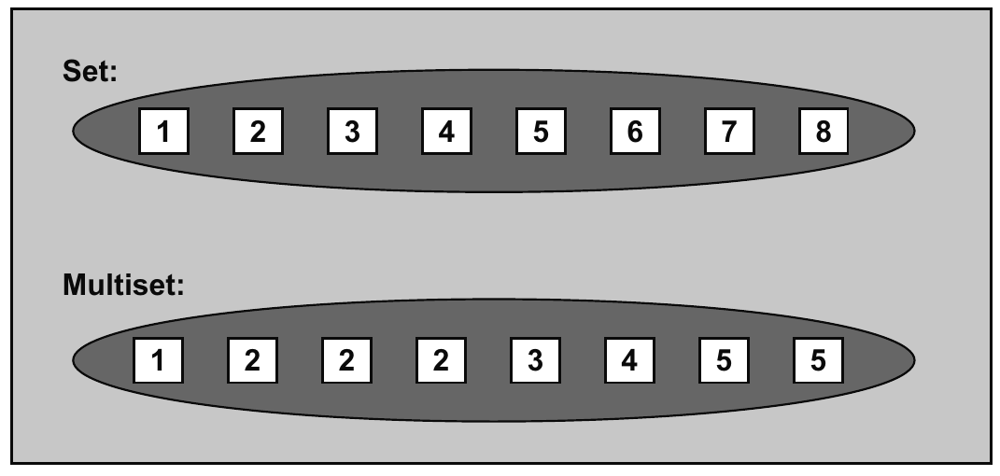
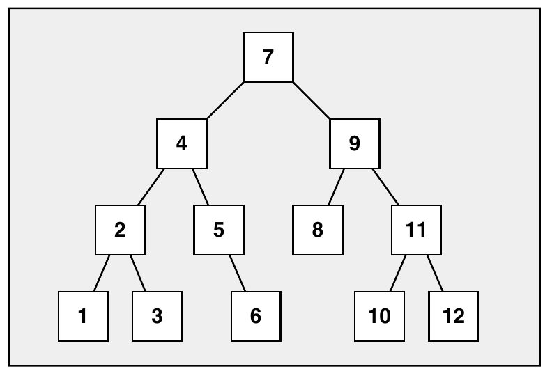

# 7.7–7.7.2 · `set`, `multiset` và thứ tự

> **Nguồn:** Nicolai M. Josuttis, *The C++ Standard Library*, ấn bản thứ hai, trang 314–320 (PDF trang 343–349). Hình được cắt từ sách; các lưu ý hiện đại được ghi riêng.

## Phần tử có thứ tự

`std::set` và `std::multiset` tự duy trì phần tử theo một tiêu chí sắp xếp. `set` chỉ giữ tối đa một phần tử trong mỗi nhóm tương đương theo tiêu chí đó; `multiset` cho phép nhiều phần tử tương đương.



*Hình 7.12 trong sách: set và multiset.*

Hai kiểu được khai báo trong `<set>` dưới dạng `std::set<T, Compare, Allocator>` và `std::multiset<T, Compare, Allocator>`. Mặc định, comparator là `std::less<T>` và allocator là `std::allocator<T>`; comparator mặc định thường dùng quan hệ `<` của kiểu phần tử.

### Thứ tự yếu chặt

Comparator `comp(a,b)` phải xác định *strict weak ordering*. Với các giá trị liên quan, những tính chất cần kiểm tra là:

1. **Phi phản xạ:** `comp(x,x)` luôn sai.
2. **Bất đối xứng:** nếu `comp(x,y)` đúng thì `comp(y,x)` sai. Sách gọi tính chất này là “antisymmetric”; tên chính xác cho quan hệ chặt là *asymmetric*.
3. **Bắc cầu:** nếu `comp(x,y)` và `comp(y,z)` đúng thì `comp(x,z)` đúng.
4. **Tính tương đương bắc cầu:** định nghĩa `equiv(a,b) = !comp(a,b) && !comp(b,a)`; nếu `a` tương đương `b` và `b` tương đương `c`, thì `a` tương đương `c`.

Chẳng hạn `<=` không hợp lệ vì `x <= x` đúng. Hai giá trị được coi là trùng theo container khi **không giá trị nào đứng trước giá trị kia**, không nhất thiết khi `operator==` trả đúng. Trong multiset, từ C++11, chèn và xóa bảo toàn thứ tự tương đối của các phần tử tương đương còn lại.

## 7.7.1 Khả năng và cấu trúc

Một implementation thường dùng cây tìm kiếm cân bằng, chẳng hạn cây đỏ–đen. Hình dưới là minh họa; chuẩn quy định hành vi và độ phức tạp, không bắt buộc cấu trúc cây cụ thể.



*Hình 7.13 trong sách: một cấu trúc cây có thể dùng cho set và multiset.*

Các phép tìm kiếm thành viên thông thường có độ phức tạp logarithmic theo số phần tử. Sách so sánh ví dụ một tập khoảng 1.000 phần tử với tìm tuyến tính; số phép so sánh thực tế còn phụ thuộc dữ liệu và implementation.

Vì thứ tự phụ thuộc giá trị, không thể sửa khóa trực tiếp thông qua iterator: phần tử được nhìn như `const`. Cách truyền thống là xóa giá trị cũ và chèn giá trị mới. Từ C++17, có thể `extract` một node, sửa giá trị của node handle rồi chèn lại; khi chèn vào `set`, vẫn phải xử lý trường hợp khóa mới tương đương với khóa đã có.

## 7.7.2 Tạo container và comparator

Có thể tạo container rỗng, copy hoặc move, từ phạm vi `[first,last)`, từ initializer list, và truyền đối tượng comparator cho constructor. Kiểu comparator là một phần của kiểu container; đối tượng comparator còn có thể mang trạng thái riêng:

```cpp
#include <functional>
#include <set>

std::set<int> ascending{1, 4, 2};
std::set<int, std::greater<int>> descending{1, 4, 2};
// Duyệt ascending: 1 2 4; duyệt descending: 4 2 1
```

Comparator dùng để xác định sự tương đương khóa nên không bắt buộc `operator==` để tìm hoặc chèn. Ngược lại, khi so sánh hai container bằng `==`, các phần tử được so sánh bằng `operator==`; hai loại tương đương này có thể cho kết quả khác nhau. So sánh trực tiếp container cần các kiểu tương thích theo overload; ví dụ `set<int>` và `set<int, greater<int>>` là hai kiểu khác nhau.

`key_comp()` trả bản sao comparator của khóa; với set/multiset, `value_comp()` cũng dùng cùng tiêu chí vì giá trị chính là khóa. `empty()`, `size()`, `max_size()` và các phép so sánh container hoạt động như nhóm container có thứ tự; phép so sánh thứ tự container xét các phần tử theo thứ tự từ điển, không phải gọi comparator của container để so sánh từng cặp.

## Tìm kiếm theo khóa

| Thao tác | Kết quả |
|:---|:---|
| `c.find(key)` | Iterator tới một phần tử tương đương, hoặc `end()` nếu không có. Với multiset, không nên dựa vào `find` để lấy phần tử tương đương đầu tiên; dùng `lower_bound`. |
| `c.count(key)` | Số phần tử tương đương; với set chỉ có thể là 0 hoặc 1. |
| `c.lower_bound(key)` | Iterator đầu tiên `it` sao cho `!comp(*it, key)`, hoặc `end()`. |
| `c.upper_bound(key)` | Iterator đầu tiên `it` sao cho `comp(key, *it)`, hoặc `end()`. |
| `c.equal_range(key)` | Cặp iterator `[lower_bound, upper_bound)` chứa tất cả phần tử tương đương. |

Các mô tả “lớn hơn hoặc bằng” và “lớn hơn” chỉ tương ứng với comparator tăng dần thông thường. Các iterator trả về có thể là `end()` và không được dereference trong trường hợp đó. `find`/`lower_bound` thành viên tận dụng cấu trúc của container; `std::find` tổng quát duyệt tuyến tính. `count` và `equal_range` với nhiều phần tử tương đương còn phụ thuộc số lượng kết quả.

Ví dụ của sách dùng các giá trị 1, 2, 4, 5, 6:

```cpp
#include <iostream>
#include <set>

int main() {
    std::set<int> c{1, 2, 4, 5, 6};
    for (int key : {3, 5}) {
        auto range = c.equal_range(key);
        std::cout << key << ": " << *range.first << ' ' << *range.second << '\n';
    }
}
```

Kết quả là `3: 4 4` và `5: 5 6`. Với 3, hai iterator bằng nhau nên phạm vi rỗng; với 5, phạm vi chứa một phần tử. Ví dụ này chỉ dereference an toàn vì các giá trị cụ thể bảo đảm cả hai iterator khác `end()`. Từ C++20 có thêm `contains(key)` để hỏi có phần tử tương đương hay không.
