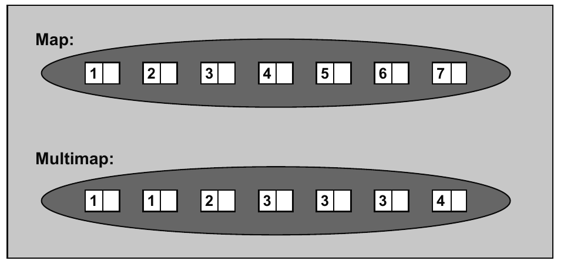
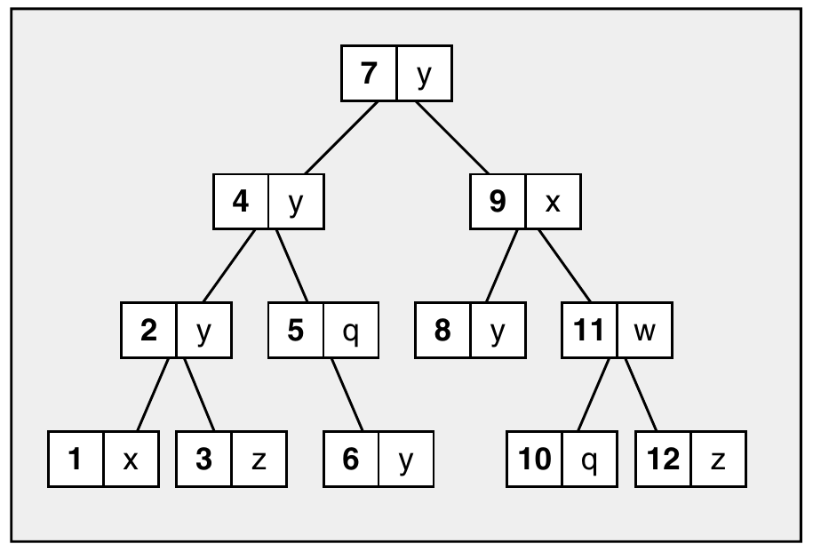

# 7.7.5–7.8.2 · Comparator lúc chạy và `map`

> **Nguồn:** Nicolai M. Josuttis, *The C++ Standard Library*, ấn bản thứ hai, trang 328–336 (PDF trang 357–365). Các hình được cắt từ sách.

## 7.7.5 Chọn thứ tự lúc chạy

Kiểu comparator là một phần của kiểu `set`, nhưng đối tượng comparator có thể lưu trạng thái được chọn lúc chạy. Ví dụ sau giữ nguyên ý tưởng của sách, với hàm in tự đủ thay cho header phụ:

```cpp
#include <iostream>
#include <set>

class RuntimeCmp {
public:
    enum cmp_mode { normal, reverse };
private:
    cmp_mode mode;
public:
    RuntimeCmp(cmp_mode m = normal) : mode(m) {}
    template <typename T>
    bool operator()(const T& a, const T& b) const {
        return mode == normal ? a < b : b < a;
    }
    bool operator==(const RuntimeCmp& other) const {
        return mode == other.mode;
    }
};
using IntSet = std::set<int, RuntimeCmp>;

void print(const char* label, const IntSet& values) {
    std::cout << label;
    for (int value : values) std::cout << value << ' ';
    std::cout << '\n';
}

int main() {
    IntSet coll1{4, 7, 5, 1, 6, 2, 5};
    print("coll1: ", coll1);
    RuntimeCmp reverse_order(RuntimeCmp::reverse);
    IntSet coll2(reverse_order);
    coll2 = {4, 7, 5, 1, 6, 2, 5};
    print("coll2: ", coll2);
    coll1 = coll2;
    coll1.insert(3);
    print("coll1: ", coll1);
    if (coll1.value_comp() == coll2.value_comp())
        std::cout << "coll1 and coll2 have the same sorting criterion\n";
}
```

```text
coll1: 1 2 4 5 6 7
coll2: 7 6 5 4 2 1
coll1: 7 6 5 4 3 2 1
coll1 and coll2 have the same sorting criterion
```

Cả hai container có cùng kiểu `IntSet`, dù comparator ban đầu khác trạng thái. Khi `coll1 = coll2`, comparator cũng được gán, do đó phần tử 3 được chèn theo thứ tự giảm dần. `operator==` của `RuntimeCmp` trong ví dụ được tác giả tự định nghĩa để so sánh hai trạng thái; đó không phải yêu cầu chung cho mọi comparator. Không thay đổi thứ tự mà comparator áp dụng đối với các khóa đang ở trong container, vì điều đó có thể phá vỡ bất biến sắp xếp.

## 7.8 · `map` và `multimap`

Map quản lý các cặp khóa–giá trị, sắp xếp theo **khóa**. `std::map` chỉ giữ một phần tử cho mỗi nhóm khóa tương đương; `std::multimap` cho phép nhiều phần tử có khóa tương đương.



*Hình 7.14 trong sách: map và multimap.*

Cả hai được khai báo trong `<map>` và có dạng `std::map<Key, T, Compare, Allocator>` hoặc `std::multimap<Key, T, Compare, Allocator>`. Comparator mặc định là `std::less<Key>`; allocator mặc định dành cho `std::pair<const Key, T>`. Trong cặp này, `first` là khóa hằng và `second` là giá trị liên kết.

Comparator phải tạo *strict weak ordering*, như ở phần set. Hai khóa tương đương khi không khóa nào đứng trước khóa kia theo comparator; giá trị liên kết không ảnh hưởng thứ tự. Từ C++11, việc chèn và xóa trong multimap bảo toàn thứ tự tương đối của các phần tử có khóa tương đương còn lại.

Sách nêu key và value phải copy hoặc move được. Yêu cầu chính xác phụ thuộc thao tác: một số kiểu không copy/move được vẫn có thể được dựng trực tiếp trong map bằng overload phù hợp, chẳng hạn `try_emplace`; không phải mọi thao tác đều dùng được với mọi kiểu.

### 7.8.1 Đặc điểm



*Hình 7.15 trong sách: một cấu trúc cây minh họa cho map và multimap.*

Các implementation thường dùng cây cân bằng, nhưng chuẩn không bắt buộc cấu trúc này. Tìm theo khóa có độ phức tạp logarithmic; tìm theo giá trị liên kết thường cần duyệt tuyến tính vì map không được sắp theo giá trị. Có thể sửa `it->second` nếu giá trị không hằng; không thể sửa `it->first` thông qua iterator. Với C++17, node handle từ `extract` cho phép sửa khóa ngoài container rồi chèn lại, kèm kiểm tra xung đột trong `map`.

`map` có thể dùng như mảng kết hợp thông qua `operator[]`; `multimap` không có phép này do một khóa có thể tương ứng nhiều giá trị. Chi tiết và tác động khi khóa chưa tồn tại sẽ được trình bày ở phần tiếp theo.

## 7.8.2 Tạo, tìm kiếm và gán

Có thể tạo map rỗng, copy/move, từ phạm vi cặp khóa–giá trị, từ initializer list, hoặc truyền comparator có trạng thái. Kiểu comparator là tham số template thứ ba; các phần tử trong phạm vi nguồn phải thích hợp để tạo `value_type`. `key_comp()` trả comparator của khóa; `value_comp()` so sánh hai cặp bằng cách so sánh khóa của chúng.

Các thao tác `empty`, `size`, `max_size` và so sánh container hoạt động tương tự set. Khi so sánh hai map bằng `==`, các cặp phần tử được so sánh; comparator dùng để xác định tương đương khóa trong container không thay thế phép so sánh đó. Các map có kiểu comparator khác nhau là kiểu khác nhau và không thể dùng trực tiếp overload so sánh container thông thường.

| Hàm thành viên | Kết quả theo khóa |
|:---|:---|
| `find(key)` | Iterator tới một phần tử có khóa tương đương hoặc `end()`. |
| `count(key)` | Số phần tử có khóa tương đương. |
| `lower_bound(key)` | Vị trí đầu tiên có khóa không đứng trước `key` theo comparator. |
| `upper_bound(key)` | Vị trí đầu tiên có khóa đứng sau `key` theo comparator. |
| `equal_range(key)` | Phạm vi nửa mở chứa tất cả phần tử có khóa tương đương. |

Với thứ tự tăng dần mặc định, `lower_bound` là khóa đầu tiên không nhỏ hơn khóa tìm, `upper_bound` là khóa đầu tiên lớn hơn. Trước khi dereference iterator, kiểm tra nó khác `end()`. Từ C++20, `contains(key)` cho phép kiểm tra sự tồn tại theo khóa.

Không thể dùng `find` thành viên để tìm theo `second`; sách minh họa duyệt toàn bộ container:

```cpp
for (const auto& entry : coll) {
    if (entry.second == desired_value) {
        // xử lý entry.first và entry.second
    }
}
```

Có thể dùng `std::find_if` cho nhu cầu tương tự. Nếu xóa trong lúc duyệt, cần dùng iterator mà `erase` trả về để không tiếp tục sử dụng iterator đã mất hiệu lực. Copy/move assignment, gán initializer list và `swap` có điều kiện kiểu và allocator tương ứng; comparator có trạng thái cũng được gán hoặc hoán đổi.
