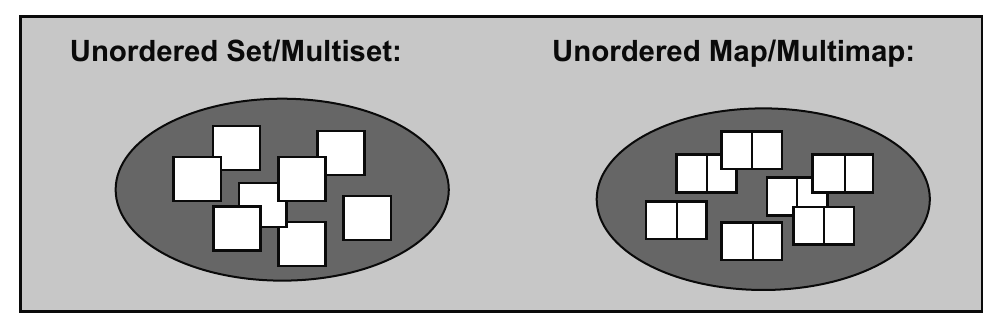
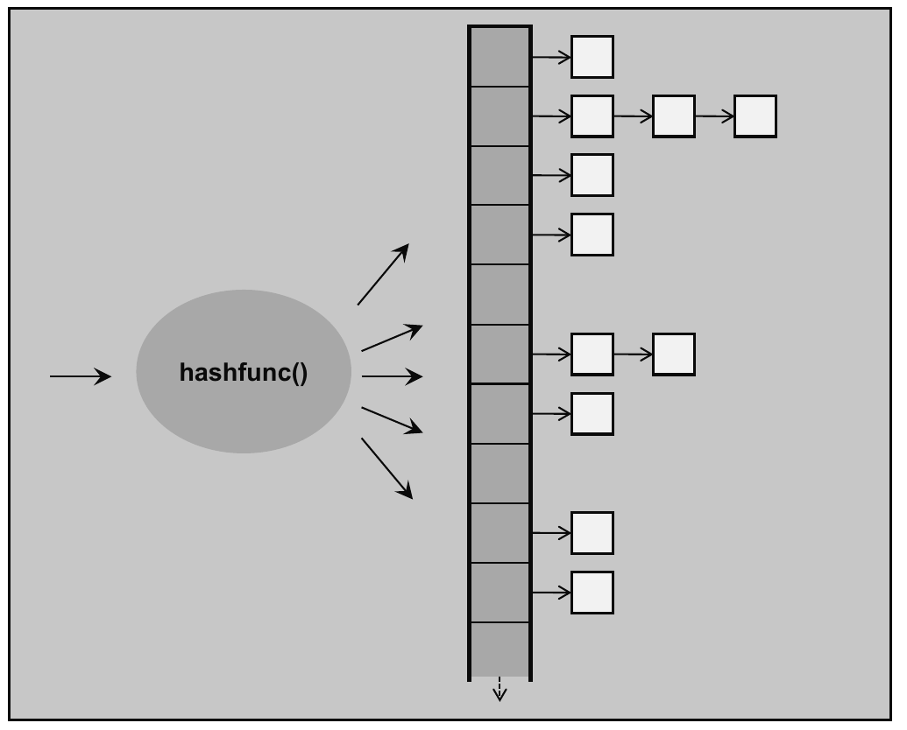
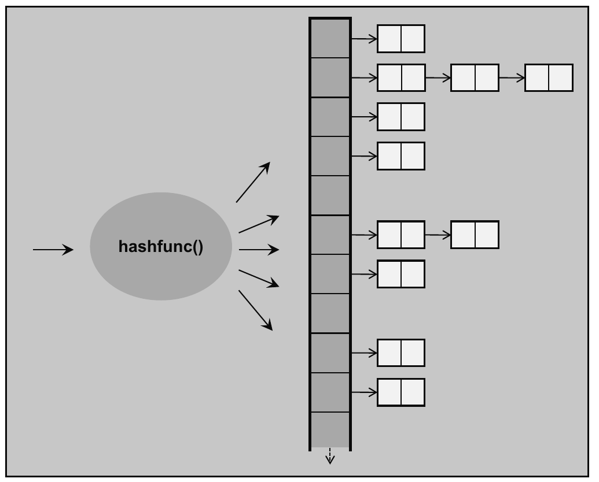

# 7.9–7.9.2 · Unordered container và bảng băm

> **Nguồn:** Nicolai M. Josuttis, *The C++ Standard Library*, ấn bản thứ hai, trang 355–362 (PDF trang 384–391). Các hình được cắt từ sách; các chỗ cần làm rõ được ghi trong nội dung.

## Bốn container không có thứ tự sắp xếp

Sách kể lại rằng các thư viện C++ từng có nhiều phiên bản `hash_set` và `hash_map` không hoàn toàn tương thích. TR1 đưa vào một nhóm giao diện thống nhất với tiền tố `unordered_`; các container này sau đó trở thành một phần thư viện chuẩn C++11.



*Hình 7.16 trong sách: unordered set/multiset và unordered map/multimap · trang 355 (PDF trang 384).*

Hình bên trái biểu diễn từng giá trị; hình bên phải biểu diễn các cặp khóa–giá trị. Vị trí trong hình mang tính minh họa, không quy định thứ tự duyệt.

| Kiểu | Header | Lưu trữ | Khóa tương đương |
|:---|:---|:---|:---|
| `unordered_set<T>` | `<unordered_set>` | Giá trị đồng thời là khóa | Tối đa một |
| `unordered_multiset<T>` | `<unordered_set>` | Giá trị đồng thời là khóa | Có thể nhiều |
| `unordered_map<Key,T>` | `<unordered_map>` | Cặp khóa–giá trị | Tối đa một |
| `unordered_multimap<Key,T>` | `<unordered_map>` | Cặp khóa–giá trị | Có thể nhiều |

Thứ tự duyệt không được sắp xếp theo khóa và không nên dựa vào thứ tự quan sát được. Nó cũng không có nghĩa là thứ tự ngẫu nhiên theo một phân phối xác suất. Với multiset/multimap, các phần tử có khóa tương đương tạo thành một nhóm liên tiếp khi duyệt; các thao tác liên quan bảo toàn thứ tự tương đối của các phần tử tương đương theo bảo đảm của chuẩn.

Các template nhận hash function, predicate kiểm tra tương đương và allocator. Mặc định, hash là `std::hash<Key>`, predicate là `std::equal_to<Key>`; kiểu phần tử của map là `std::pair<const Key,T>`. Không phải mọi kiểu tùy ý đều có `std::hash` sử dụng được; kiểu tự định nghĩa có thể cần hash và predicate tương ứng. Yêu cầu copy/move phụ thuộc từng thao tác, không phải một điều kiện đơn giản áp dụng cho mọi cách sử dụng.

## 7.9.1 Hash, bucket và va chạm

Hash function tính một giá trị hash từ khóa; container ánh xạ giá trị đó vào một **bucket**. Một cách implementation thường gặp là mỗi bucket liên kết tới các nút phần tử. Với set, nút biểu diễn giá trị; với map, nút biểu diễn cặp khóa–giá trị:



*Hình 7.17 trong sách: cấu trúc bucket minh họa cho unordered set/multiset.*



*Hình 7.18 trong sách: cấu trúc minh họa cho unordered map/multimap.*

Hai khóa khác nhau có thể có cùng hash; ngay cả hai hash khác nhau cũng có thể được ánh xạ vào cùng bucket. Vì vậy câu trong sách mô tả mọi phần tử cùng bucket là có cùng hash cần được hiểu thận trọng. Container dùng predicate tương đương để phân biệt các khóa trong nhóm ứng viên. **Nếu hai khóa được predicate coi là tương đương, hash của chúng phải bằng nhau**; chiều ngược lại không bắt buộc. Kết quả hash và tương đương cho các khóa đang lưu phải nhất quán.

Hash tốt và phân bố dữ liệu phù hợp thường cho tìm kiếm, chèn, xóa theo khóa độ phức tạp trung bình hằng số; trường hợp xấu nhất có thể tuyến tính. Rehash có thể tốn kém hơn một thao tác thông thường. Không nên hiểu đây là bảo đảm thời gian chạy hằng cho mọi dữ liệu hoặc mọi overload.

So với container có thứ tự, nhóm này không có `lower_bound`, `upper_bound` hay phép so sánh thứ tự `<`, `>` giữa container. Iterator được bảo đảm ít nhất là forward iterator; không dựa vào duyệt ngược. Không sửa khóa trực tiếp qua iterator vì nó quyết định bucket; với map, có thể sửa `second`. `unordered_map` còn có `operator[]` và `at()` để truy cập mapped value, nên nhận định tổng quát trong sách rằng unordered container không có truy cập trực tiếp cần tính tới ngoại lệ này.

## 7.9.2 Tạo và điều khiển bảng

Constructor có thể tạo container rỗng, từ container cùng kiểu, phạm vi hoặc initializer list. Các overload phù hợp còn nhận số bucket tối thiểu ban đầu, hash function, predicate và allocator. Hash và predicate có thể là đối tượng có trạng thái; kiểu của chúng là tham số template.

| Thao tác | Ý nghĩa |
|:---|:---|
| `hash_function()` / `key_eq()` | Trả bản sao hash function / predicate. |
| `bucket_count()` / `max_bucket_count()` | Số bucket hiện tại / giới hạn tối đa. |
| `load_factor()` | Tỉ số `size() / bucket_count()` dưới dạng số thực. |
| `max_load_factor()` / `max_load_factor(x)` | Đọc / đặt ngưỡng tải dương được container dùng khi quản lý bucket. |
| `rehash(n)` | Yêu cầu ít nhất `n` bucket và đủ bucket để thỏa điều kiện tải hiện tại. |
| `reserve(n)` | Chuẩn bị theo **số phần tử**; tương đương yêu cầu rehash dựa trên `ceil(n / max_load_factor())`. |

```cpp
#include <string>
#include <unordered_set>

std::unordered_set<std::string> names;
names.max_load_factor(0.7f);
names.reserve(100); // chuẩn bị theo số phần tử, không phải số bucket
```

Với ngưỡng 0,7, 100 phần tử cần ít nhất `ceil(100 / 0,7) = 143` bucket theo tính toán; implementation có thể chọn nhiều hơn. `rehash(100)` yêu cầu ít nhất 100 bucket, **không** tự có nghĩa là chuẩn bị cho 100 phần tử ở mọi ngưỡng tải. Sách gợi ý 0,7–0,8 như một kinh nghiệm; đây không phải giá trị tối ưu phổ quát, cần đo với dữ liệu thực tế.

Rehash làm mất hiệu lực iterator, thay đổi phân bố bucket và có thể đổi thứ tự duyệt, nhưng không làm mất hiệu lực con trỏ hoặc tham chiếu tới phần tử còn tồn tại. `erase` chỉ làm mất hiệu lực iterator và tham chiếu tới phần tử bị xóa. Lưu ý `clear()` xóa **tất cả** phần tử nên mọi iterator/tham chiếu tới chúng đều không còn hợp lệ. Chi tiết về iterator và các thao tác sẽ được tiếp tục ở phần sau.
