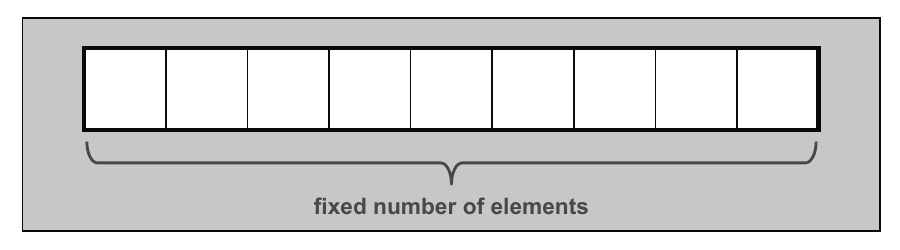

# 7.2–7.2.5 · `std::array`

> **Phạm vi:** Giới thiệu, khả năng, thao tác, giao tiếp C và tuple interface của `array`. Ví dụ đầy đủ ở mục 7.2.6 tiếp tục sau.  
> **Nguồn:** Nicolai M. Josuttis, *The C++ Standard Library*, ấn bản thứ hai, trang 261–268 (PDF trang 290–297). Ghi chú bổ sung được đánh dấu riêng.

`std::array<T, N>` trong `<array>` là container bọc một dãy phần tử liên tục có **kích thước cố định** `N`, là một phần của kiểu. Không thể thêm hay xóa để thay đổi `N`; có thể thay giá trị phần tử. Nó hỗ trợ random-access iterator và không nhận allocator như vector.



*Hình 7.1 trong sách: cấu trúc array với số lượng phần tử cố định · trang 261 (PDF trang 290).*

Không nên coi “luôn nằm trên stack” là bảo đảm: vị trí lưu trữ phụ thuộc nơi đối tượng `array` được tạo. Nó không tự tái cấp phát vùng phần tử như vector khi tăng kích thước.

## 7.2.1 Khởi tạo, swap và kích thước

`array` là aggregate. Với biến cục bộ số nguyên không được khởi tạo, phần tử không có giá trị xác định; ngoặc rỗng value-initialize các phần tử:

```cpp
std::array<int, 4> a;             // không đọc các phần tử trước khi gán
std::array<int, 4> b{};           // 0 0 0 0
std::array<int, 5> c{42, 377};    // 42 377 0 0 0
// std::array<int, 2> d{1, 2, 3}; // lỗi: quá nhiều phần tử
```

Các phần tử cung cấp phải khởi tạo được kiểu `T`; list-initialization có quy tắc cấm narrowing. Không phụ thuộc tên thành viên nội bộ của implementation. Các quy tắc aggregate và cú pháp khởi tạo đã thay đổi giữa các phiên bản C++; ví dụ của sách về cú pháp ngoặc tròn phản ánh C++11.

Copy/move/swap của array xử lý các phần tử; `swap` có độ phức tạp tuyến tính theo `N`, không chỉ đổi con trỏ. Iterator và tham chiếu vẫn gắn với vị trí trong array ban đầu, nhưng giá trị tại vị trí có thể đã đổi.

`std::array<T,0>` hợp lệ và rỗng: `begin() == end()`. Không gọi `front()`, `back()` hoặc truy cập chỉ số trên array rỗng. `data()` của array rỗng có thể trả giá trị không xác định cụ thể; không dereference nó.

## 7.2.2 Các thao tác

| Nhóm | Thao tác | Ý nghĩa |
|:---|:---|:---|
| Tạo | `array<T,N> a`, copy/move, `a{...}` | Tạo `N` phần tử theo cách khởi tạo phù hợp. |
| Kích thước | `empty()`, `size()`, `max_size()` | Với một kiểu array, kích thước luôn là `N`. |
| So sánh | `==`, `!=`, các phép thứ tự được hỗ trợ | So sánh theo phần tử và quy tắc phiên bản chuẩn. |
| Gán | `a = b`, `a = std::move(b)` | Gán từng phần tử khi hợp lệ. |
| Gán đồng loạt | `a.fill(value)` | Gán cùng giá trị cho mọi phần tử. |
| Hoán đổi | `a.swap(b)`, `swap(a,b)` | Hoán đổi từng phần tử của hai array cùng kiểu. |
| Truy cập | `a[i]`, `a.at(i)`, `front()`, `back()` | Truy cập phần tử. |
| Iterator | `begin/end`, `cbegin/cend`, `rbegin/rend`, `crbegin/crend` | Duyệt xuôi/ngược, có hoặc không const. |

*Bảng 7.4–7.8 của sách, trang 264–266, được nhóm lại.* `at(i)` ném `std::out_of_range` khi chỉ số ngoài phạm vi. `operator[]`, `front` và `back` yêu cầu vị trí hợp lệ. Iterator của array là random-access; kiểu chính xác phụ thuộc implementation, không nhất thiết là raw pointer. Chúng còn hiệu lực trong thời hạn sống của array, nhưng giá trị được trỏ tới có thể thay đổi sau `swap` hoặc gán.

:::note Kiểm tra và đồng bộ
Kiểm tra `size()` rồi truy cập không tự bảo vệ khỏi data race trong chương trình đa luồng. `array` không đổi kích thước, nhưng việc một luồng đọc trong khi luồng khác sửa cùng phần tử vẫn cần đồng bộ.
:::

## 7.2.3 Dùng với giao diện kiểu C

Các phần tử array nằm liên tục. `data()` trả con trỏ đến vùng phần tử và thích hợp khi API C yêu cầu con trỏ:

```cpp
#include <array>
#include <cstdio>
#include <cstring>

std::array<char, 41> a{};
std::strcpy(a.data(), "hello, world"); // bộ đệm đủ lớn trong ví dụ
std::printf("%s\n", a.data());
```

Với C-string, phải đủ chỗ cho ký tự kết thúc `\0` và bảo đảm nội dung hợp lệ. Đừng truyền `a.begin()` cho API đòi raw pointer chỉ vì implementation hiện tại dùng pointer làm iterator; `data()` là giao diện phù hợp. Với array rỗng, không dereference `data()` hoặc dùng `&a[0]`.

## 7.2.4 Ngoại lệ

`at()` kiểm tra chỉ số và có thể ném `std::out_of_range`; các thao tác khác có thể ném do phép toán trên phần tử hoặc callable do người dùng cung cấp. `array::swap` thực hiện swap từng phần tử nên có thể ném tùy kiểu phần tử; không mặc định nó không ném hoặc có rollback toàn bộ.

## 7.2.5 Tuple interface

Array hỗ trợ giao diện tuple:

```cpp
using FiveStrings = std::array<std::string, 5>;
FiveStrings a{"hello", "nico", "how", "are", "you"};
static_assert(std::tuple_size<FiveStrings>::value == 5, "size");
using Element = std::tuple_element<1, FiveStrings>::type; // std::string
auto& second = std::get<1>(a); // "nico"
```

Chỉ số template của `get<I>` phải hợp lệ tại thời điểm biên dịch. Từ C++17, structured bindings cũng dùng giao diện tuple-like để đặt tên các phần tử.
