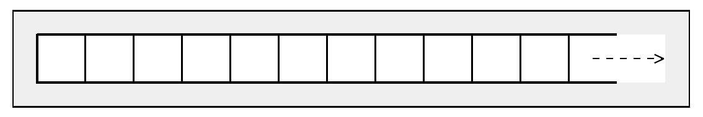

# 7.2.6–7.3.1 · Ví dụ `array` và dung lượng `vector`

> **Phạm vi:** Mục 7.2.6 và phần giới thiệu, khả năng của vector ở mục 7.3–7.3.1. Bảng thao tác vector chi tiết tiếp tục ở mục 7.3.2.  
> **Nguồn:** Nicolai M. Josuttis, *The C++ Standard Library*, ấn bản thứ hai, trang 268–272 (PDF trang 297–301). Ghi chú bổ sung được đánh dấu riêng.

## 7.2.6 Ví dụ `std::array`

Ví dụ sách tạo mười số nguyên, gán một vài phần tử, tính tổng rồi đổi dấu:

```cpp
#include <algorithm>
#include <array>
#include <functional>
#include <iostream>
#include <numeric>

int main() {
    std::array<int, 10> a{11, 22, 33, 44};
    a.back() = 9999999;
    a[a.size() - 2] = 42;
    std::cout << "sum: " << std::accumulate(a.begin(), a.end(), 0) << '\n';
    std::transform(a.begin(), a.end(), a.begin(), std::negate<int>());
    for (int value : a) std::cout << value << ' ';
    std::cout << '\n';
}
```

Các phần tử chưa được liệt kê trong initializer được khởi tạo bằng zero. Trước transform, dãy là `11 22 33 44 0 0 0 0 42 9999999`; tổng là `10000151`. Sau transform: `-11 -22 -33 -44 0 0 0 0 -42 -9999999`. Các iterator của array cho phép dùng thuật toán tổng quát. Với dữ liệu khác, cần xét tràn của `accumulate` và phép đổi dấu; kiểu tích lũy ban đầu `0` là `int`.

## 7.3 Vector

`std::vector<T, Allocator>` trong `<vector>` biểu diễn một dãy động với phần tử liên tục (ngoại trừ specialization `vector<bool>` có cách biểu diễn đặc biệt). Nó hỗ trợ random access; thêm hoặc xóa ở cuối thường hiệu quả, trong khi chèn/xóa đầu hoặc giữa có thể phải dịch các phần tử phía sau. Allocator xác định cách cấp phát theo giao diện container.



*Hình 7.2 trong sách: mô hình vector như một dãy động · trang 270 (PDF trang 299).*

Mũi tên minh họa khả năng tăng số phần tử; khi cần thêm sức chứa, vector có thể phải cấp phát lại và chuyển phần tử, không bảo đảm mở rộng vùng nhớ tại chỗ.

### `size` và `capacity`

- `size()` là số **phần tử đang tồn tại**.
- `capacity()` là số phần tử vector có thể chứa trong vùng lưu trữ hiện tại trước khi cần tăng capacity.
- `reserve(n)` yêu cầu capacity ít nhất `n` nếu hiện tại chưa đủ; không thêm phần tử và không đổi `size()`.
- `resize(n)` thay đổi số phần tử, tạo hoặc hủy phần tử theo yêu cầu.

```cpp
std::vector<int> v;
v.reserve(80); // size() == 0, capacity() >= 80
v.push_back(7); // size() == 1
std::vector<int> five(5); // năm phần tử int bằng 0
```

Tạo sẵn `n` phần tử có thể tốn chi phí constructor; nếu chỉ cần chuẩn bị vùng lưu trữ, `reserve` diễn đạt đúng mục đích. Nhưng `reserve` không tạo các đối tượng ở chỉ số ngoài `size`, nên không được dùng `v[20]` khi size chỉ là 1.

Nếu `reserve` thực sự cấp phát lại, mọi con trỏ, tham chiếu và iterator tới phần tử cũ mất hiệu lực. Sau `reserve`, các lần chèn sẽ không gây reallocation cho đến khi size mới vượt capacity, nhưng chèn ở giữa vẫn có thể làm mất hiệu lực iterator/tham chiếu **tại hoặc sau vị trí chèn**, và past-the-end iterator có thể thay đổi. Xóa phần tử cũng có quy tắc invalidation riêng.

### Thu nhỏ capacity

Gọi `reserve(n)` với `n <= capacity()` không thu nhỏ vector. Từ C++11, `shrink_to_fit()` là yêu cầu **không ràng buộc** để giảm capacity; implementation có thể không thực hiện. Nếu nó gây reallocation, iterator, con trỏ và tham chiếu tới phần tử bị vô hiệu hóa; nếu không có reallocation, chúng không bị vô hiệu hóa chỉ vì lời gọi đó.

Sách cũng trình bày thủ thuật trước C++11:

```cpp
std::vector<T>(v).swap(v); // tạo bản sao tạm rồi hoán đổi
```

Cách này cần `T` copy được, có thể tốn bộ nhớ/thời gian, và không phải hợp đồng tổng quát rằng capacity mới chắc chắn đúng bằng size. Sau khi đối tượng tạm bị hủy, iterator/con trỏ cũ tới phần tử cũ không còn dùng được. Với allocator tùy chỉnh, còn phải bảo đảm các điều kiện của `swap`; không áp dụng máy móc.

:::note Chọn dung lượng
Không có một chiến lược tăng capacity duy nhất do chuẩn quy định. `reserve` hữu ích khi có ước lượng hợp lý, nhưng gọi lặp với kích thước tăng từng phần tử có thể cản trở chiến lược tăng trưởng hiệu quả của implementation. Dùng giá trị và đo trên workload thực tế.
:::
