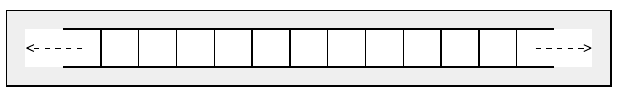
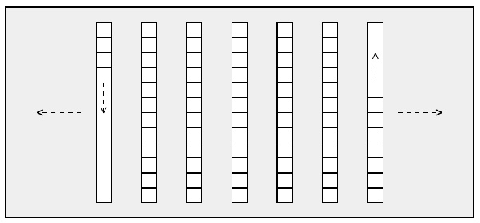

# 7.4 · `std::deque`: container hai đầu

> **Nguồn:** Nicolai M. Josuttis, *The C++ Standard Library*, ấn bản thứ hai, trang 283–289 (PDF trang 312–318). Hình minh họa được cắt từ trang 283 của sách.

## Cấu trúc và đặc điểm

`deque` (đọc gần như “deck”, viết tắt của *double-ended queue*) tương tự `vector`: số lượng phần tử thay đổi được, có truy cập ngẫu nhiên và giao diện gần giống nhau. Khác biệt đáng chú ý là thao tác thêm và xóa ở **cả đầu lẫn cuối** đều hiệu quả.



*Hình 7.3 trong sách: cấu trúc logic của deque.*

Một implementation điển hình quản lý nhiều khối bộ nhớ riêng, với khối đầu và khối cuối có thể phát triển theo hai hướng:



*Hình 7.4 trong sách: cấu trúc bên trong thường gặp; chuẩn không bắt buộc chính xác cách tổ chức này.*

Để sử dụng, thêm `#include <deque>`. Kiểu có dạng `std::deque<T, Allocator>`: `T` là kiểu phần tử, allocator có giá trị mặc định `std::allocator<T>`.

### So với vector

- Thêm hoặc xóa ở đầu và cuối có độ phức tạp hằng số theo số phần tử; sách mô tả trường hợp này là hằng số khấu hao. Thêm hoặc xóa ở giữa tương đối tốn kém vì có thể phải dịch chuyển phần tử về một phía.
- Truy cập và di chuyển iterator thường có thêm một mức gián tiếp trong cấu trúc nhiều khối, nên có thể chậm hơn vector; cần đo trên ứng dụng thực tế. Iterator hỗ trợ random access nhưng không có bảo đảm là con trỏ thông thường.
- Không giống vector, các phần tử deque **không được bảo đảm nằm liên tục**, nên không thể truyền toàn bộ deque như mảng C bằng một con trỏ.
- Những khối nhớ không còn sử dụng có thể được giải phóng; điều này phụ thuộc implementation và không được bảo đảm. Trên hệ thống hạn chế kích thước khối liên tục, cách lưu nhiều khối có thể cho phép deque chứa nhiều phần tử hơn vector.
- Deque không có `capacity()` và `reserve()` để điều khiển dung lượng. Đổi lại, việc tăng bộ nhớ trong implementation dựa trên nhiều khối có thể không cần sao chép toàn bộ phần tử.

Sách gợi ý cân nhắc deque khi thường thao tác cả hai đầu; giao diện gần giống vector giúp dễ thử cả hai. Tuy nhiên, việc deque có trả lại bộ nhớ cho hệ thống không được chuẩn bảo đảm.

## 7.4.2 Các thao tác

Bảng 7.16–7.18 của sách liệt kê các thao tác. Phần lớn giống vector, xem lại phần trước để biết chi tiết.

| Nhóm | Thao tác |
|:---|:---|
| Khởi tạo | `deque<T> d`, copy/move constructor, `deque<T> d(n)`, `d(n, value)`, `d(first, last)`, và initializer list. Destructor hủy phần tử và giải phóng tài nguyên do container sở hữu. |
| Kích thước | `empty()`, `size()`, `max_size()`, `shrink_to_fit()`. Không có `reserve()` hoặc `capacity()`. |
| So sánh | `==`, `!=`, `<`, `>`, `<=`, `>=` so sánh nội dung theo quy tắc tương ứng; từ C++20 có thêm phép so sánh ba chiều khi các điều kiện kiểu thỏa mãn. |
| Truy cập | `d[i]`, `d.at(i)`, `front()`, `back()`. Chỉ `at()` kiểm tra chỉ số và ném `std::out_of_range` khi vượt giới hạn; `front()` và `back()` yêu cầu không rỗng. |
| Iterator | `begin/end`, `cbegin/cend`, `rbegin/rend`, `crbegin/crend`. Iterator xuôi hỗ trợ truy cập ngẫu nhiên. |
| Gán và đổi | Copy/move assignment, gán initializer list; `assign(n,value)`, `assign(first,last)`, `assign({...})`; `swap`. |
| Thêm hoặc xóa hai đầu | `push_front`, `push_back`, `emplace_front`, `emplace_back`, `pop_front`, `pop_back`. Hai phép `pop` yêu cầu deque không rỗng và không trả phần tử bị xóa. |
| Chèn và xóa | `insert` một phần tử, nhiều bản sao, phạm vi hoặc initializer list; `emplace` tại vị trí; `erase` một phần tử hoặc phạm vi. Chèn trước vị trí được chỉ định, erase trả iterator tiếp theo. |
| Thay kích thước | `resize(n)`, `resize(n,value)` và `clear()`. |

`shrink_to_fit()` là yêu cầu không ràng buộc để giảm bộ nhớ; ví dụ, một implementation có thể thu gọn cấu trúc chứa con trỏ đến các khối. Nó không thay nội dung logic, nhưng có thể làm mất hiệu lực con trỏ, tham chiếu và iterator nếu bộ nhớ được tổ chức lại. Không giả định lời gọi chắc chắn thu hồi bộ nhớ.

### Iterator và tham chiếu khi thay đổi deque

Chèn ở một trong hai đầu làm mất hiệu lực các iterator hiện có, nhưng tham chiếu và con trỏ tới các phần tử đã có vẫn hợp lệ. Chèn ở giữa làm mất hiệu lực iterator, tham chiếu và con trỏ tới các phần tử.

Với xóa, cần xét vị trí: xóa ở đầu hoặc cuối làm mất hiệu lực tham chiếu tới phần tử bị xóa; xóa ở giữa làm mất hiệu lực iterator và tham chiếu tới tất cả phần tử. Iterator `end()` cũ cũng có quy tắc riêng, đặc biệt khi xóa phần tử cuối: cách đơn giản là lấy lại `end()` sau khi sửa container. Không dùng iterator đã mất hiệu lực. Sách trình bày quy tắc tổng quát thận trọng hơn cho việc xóa.

:::note `emplace`
`emplace` chuyển tiếp đối số để xây dựng phần tử; không nhất thiết chèn một bản sao như mô tả ngắn trong bảng gốc. Trong C++11, `emplace_front/back` trả `void`; từ C++17 chúng trả tham chiếu tới phần tử được thêm.
:::

## 7.4.3 Xử lý ngoại lệ

Sách trình bày deque có các bảo đảm tương tự vector: nếu `push_front()` hoặc `push_back()` ném trong lúc chèn, thao tác không có tác động; `pop_front()` và `pop_back()` không ném. Các bảo đảm này cần được đọc cùng điều kiện về kiểu phần tử, allocator và phiên bản chuẩn như phần vector; gọi `pop` trên container rỗng vẫn vi phạm tiền điều kiện. Xem thêm thảo luận exception safety ở chương 6.

## 7.4.4 Ví dụ

Ví dụ trong sách tạo ba chuỗi, thêm vào hai đầu, xóa chúng, sửa các phần tử còn lại rồi tăng kích thước:

```cpp
#include <algorithm>
#include <deque>
#include <iostream>
#include <iterator>
#include <string>

int main() {
    std::deque<std::string> coll;
    coll.assign(3, std::string("string"));
    coll.push_back("last string");
    coll.push_front("first string");
    std::copy(coll.cbegin(), coll.cend(),
              std::ostream_iterator<std::string>(std::cout, "\n"));
    std::cout << '\n';

    coll.pop_front();
    coll.pop_back();
    for (std::deque<std::string>::size_type i = 1; i < coll.size(); ++i) {
        coll[i] = "another " + coll[i];
    }
    coll.resize(4, "resized string");
    std::copy(coll.cbegin(), coll.cend(),
              std::ostream_iterator<std::string>(std::cout, "\n"));
}
```

Kết quả:

```text
first string
string
string
string
last string

string
another string
another string
resized string
```
