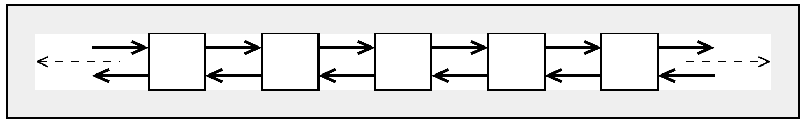
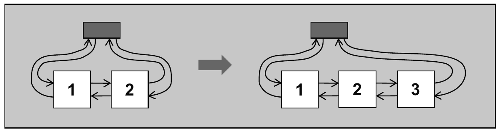
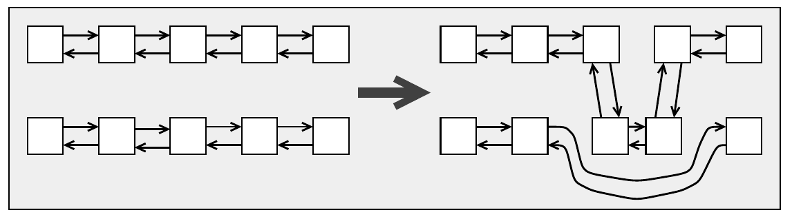

# 7.5–7.5.3 · `std::list`

> **Nguồn:** Nicolai M. Josuttis, *The C++ Standard Library*, ấn bản thứ hai, trang 290–297 (PDF trang 319–326). Các hình được cắt từ sách; ghi chú bổ sung được nêu riêng.

## Danh sách liên kết kép

`std::list<T>` quản lý các phần tử theo mô hình danh sách liên kết kép: mỗi phần tử có quan hệ liên kết với phần tử trước và sau. Chuẩn quy định giao diện và các bảo đảm của container, không áp đặt một sơ đồ bộ nhớ cụ thể.



*Hình 7.5 trong sách: cấu trúc logic của list.*

Dùng `#include <list>`. Template `std::list<T, Allocator>` nhận kiểu phần tử `T`; allocator mặc định là `std::allocator<T>`. Hình sau minh họa một cách implementation nối thêm nút bằng cách điều chỉnh liên kết:



*Hình 7.6 trong sách: minh họa thêm một phần tử.*

### Đặc điểm

- Không có truy cập ngẫu nhiên: muốn tới phần tử thứ năm thường phải đi qua các liên kết từ đầu hoặc cuối. Vì vậy không có `operator[]` hay `at()`; `front()` và `back()` truy cập hai đầu.
- Nếu đã có iterator hợp lệ tới vị trí cần thao tác, chèn hoặc xóa **một phần tử** ở đó có độ phức tạp hằng số. Chi phí tìm vị trí có thể là tuyến tính; chèn hoặc xóa nhiều phần tử phải tính theo số phần tử liên quan.
- Việc chèn không làm mất hiệu lực iterator và tham chiếu tới các phần tử sẵn có. Xóa chỉ làm mất hiệu lực iterator và tham chiếu tới các phần tử bị xóa.
- Không có `capacity()` hoặc `reserve()`. Các phần tử không được bảo đảm nằm trong một vùng nhớ liên tục.
- Có các hàm thành viên chuyên biệt như `remove`, `splice`, `sort`, `merge`, cho phép thực hiện thao tác phù hợp với danh sách liên kết. Không nên mặc định chúng nhanh hơn trong mọi tình huống: cần cân nhắc cả chi phí duyệt, bộ nhớ và đặc điểm dữ liệu.

## 7.5.2 Các thao tác thông thường

Các bảng 7.19–7.24 trong sách mô tả những nhóm sau:

| Nhóm | Thao tác |
|:---|:---|
| Tạo và hủy | Tạo rỗng, copy/move, `list<T>(n)`, `list<T>(n,value)`, từ phạm vi `[first,last)` hoặc initializer list. Destructor hủy các phần tử và giải phóng tài nguyên do list sở hữu. |
| Trạng thái | `empty()`, `size()`, `max_size()` và các phép so sánh nội dung. |
| Gán | Copy/move assignment, initializer list, `assign(n,value)`, `assign(first,last)`, `assign({...})`, `swap`. |
| Truy cập | `front()`, `back()`; cả hai yêu cầu list không rỗng. |
| Iterator | `begin/end`, `cbegin/cend`, `rbegin/rend`, `crbegin/crend`. |
| Chèn và xóa | `push_front/back`, `pop_front/back`, `insert`, `emplace`, `emplace_front/back`, `erase`, `remove`, `remove_if`, `resize`, `clear`. |

`front()`, `back()` và các phép `pop` không kiểm tra list có rỗng hay không. Trong chương trình đa luồng, việc kiểm tra `empty()` rồi truy cập cần được đồng bộ thích hợp nếu luồng khác có thể sửa container giữa hai thao tác.

Iterator list là **bidirectional**: đi được tiến và lùi nhưng không hỗ trợ truy cập ngẫu nhiên. Ví dụ, `std::sort` yêu cầu random-access iterator nên không nhận iterator của list; dùng `list::sort()` để sắp xếp.

`insert` chèn trước vị trí chỉ định; `erase` trả iterator tới phần tử tiếp theo. Các iterator và phạm vi truyền vào phải hợp lệ. Khi xóa nhiều phần tử, `remove` và `remove_if` của list trực tiếp xóa các nút thỏa điều kiện:

```cpp
#include <algorithm>
#include <list>

std::list<int> values{1, 2, 3, 2, 4};
values.remove(2);                         // xóa mọi phần tử bằng 2
values.remove_if([](int n) { return n % 2 == 0; }); // xóa mọi số chẵn

auto it = std::find(values.begin(), values.end(), 3);
if (it != values.end()) values.erase(it); // chỉ xóa lần xuất hiện đầu
```

Khác với thuật toán tổng quát `std::remove`, hàm thành viên `list::remove` thực sự xóa phần tử. Từ C++20, các hàm thành viên `remove` và `remove_if` trả về số phần tử đã xóa; trước đó chúng trả `void`.

## Thao tác chuyên biệt: đổi thứ tự và chuyển nút



*Hình 7.7 trong sách: thay liên kết khi chuyển phần tử giữa các list.*

| Thao tác | Ý nghĩa |
|:---|:---|
| `c.unique()` / `c.unique(pred)` | Xóa các phần tử trùng **liền kề**, giữ phần tử đầu của mỗi nhóm; overload predicate xác định hai phần tử liên tiếp có được xem là tương đương không. |
| `c.splice(pos, other)` | Chuyển toàn bộ phần tử của `other` tới trước `pos`. |
| `c.splice(pos, other, it)` | Chuyển phần tử tại `it` tới trước `pos`. |
| `c.splice(pos, other, first, last)` | Chuyển phạm vi `[first,last)` tới trước `pos`. |
| `c.sort()` / `c.sort(comp)` | Sắp xếp list theo thứ tự mặc định hoặc bộ so sánh. |
| `c.merge(other)` / `c.merge(other, comp)` | Trộn hai list đã được sắp xếp theo cùng tiêu chí; sau khi trộn thành công giữa hai list khác nhau, `other` rỗng. |
| `c.reverse()` | Đảo thứ tự phần tử. |

Với `splice` và `merge` giữa hai list, allocator phải so sánh bằng nhau theo yêu cầu của thao tác; sai tiền điều kiện dẫn đến hành vi không xác định. Khi splice trong cùng một list, phải tuân thủ quy tắc của từng overload, đặc biệt vị trí đích không được nằm trong phạm vi đang chuyển. Iterator và tham chiếu tới các phần tử được chuyển vẫn trỏ tới chúng, nhưng nay các phần tử thuộc list đích. Chuyển một phạm vi giữa hai list có thể tốn thời gian tuyến tính theo độ dài phạm vi, dù việc nối lại liên kết chỉ cần số thao tác cố định.

## 7.5.3 Ngoại lệ

Sách nhận xét list cung cấp nhiều bảo đảm ngoại lệ mạnh nhờ cấu trúc liên kết. Theo bảng 7.26, `push_front/back`, `insert` và `resize` có bảo đảm thành công hoặc không tác động trong các điều kiện nêu bởi chuẩn; `pop_front/back`, `erase`, `clear`, `splice`, `reverse` và `swap` không ném khi đáp ứng tiền điều kiện. `remove`, `remove_if` và `unique` phụ thuộc vào phép so sánh hoặc predicate; `merge` cũng phụ thuộc vào comparator.

Sách phân biệt assignment và `sort`: khi có ngoại lệ, không nên mặc định toàn bộ kết quả được hoàn tác. Ví dụ, comparator ném trong `sort` có thể khiến thứ tự phần tử không được xác định, dù list vẫn hợp lệ. Bảo đảm cụ thể phụ thuộc overload, allocator, thao tác phần tử và phiên bản C++; destructor không được để ngoại lệ thoát ra trong quá trình hủy thông thường.
