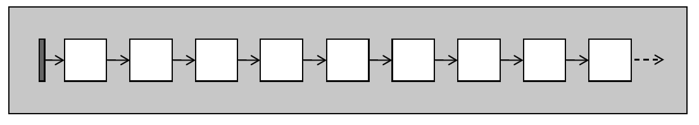
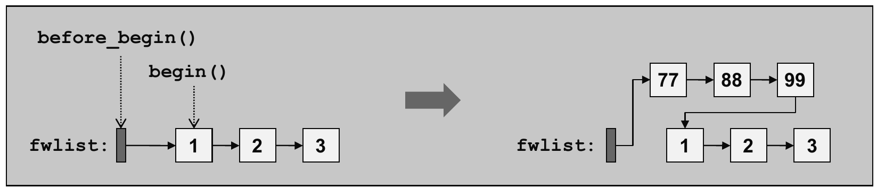

# 7.5.4–7.6.2 · Ví dụ list và danh sách liên kết đơn

> **Nguồn:** Nicolai M. Josuttis, *The C++ Standard Library*, ấn bản thứ hai, trang 298–307 (PDF trang 327–336). Hình được cắt từ sách.

## 7.5.4 Ví dụ các thao tác của list

Chương trình dưới đây theo đúng trình tự ví dụ sách: tạo hai list có thứ tự ngược nhau, chuyển nút bằng `splice`, sắp xếp, loại phần tử trùng liền kề rồi trộn hai list đã sắp xếp.

```cpp
#include <algorithm>
#include <iostream>
#include <iterator>
#include <list>

void printLists(const std::list<int>& a, const std::list<int>& b) {
    std::cout << "list1: ";
    std::copy(a.cbegin(), a.cend(), std::ostream_iterator<int>(std::cout, " "));
    std::cout << "\nlist2: ";
    std::copy(b.cbegin(), b.cend(), std::ostream_iterator<int>(std::cout, " "));
    std::cout << "\n\n";
}

int main() {
    std::list<int> list1, list2;
    for (int i = 0; i < 6; ++i) {
        list1.push_back(i);
        list2.push_front(i);
    }
    printLists(list1, list2);

    list2.splice(std::find(list2.begin(), list2.end(), 3), list1);
    printLists(list1, list2);
    list2.splice(list2.end(), list2, list2.begin());
    printLists(list1, list2);

    list2.sort();
    list1 = list2;
    list2.unique();
    printLists(list1, list2);
    list1.merge(list2);
    printLists(list1, list2);
}
```

Kết quả, với khoảng trắng cuối dòng được lược đi:

```text
list1: 0 1 2 3 4 5
list2: 5 4 3 2 1 0

list1:
list2: 5 4 0 1 2 3 4 5 3 2 1 0

list1:
list2: 4 0 1 2 3 4 5 3 2 1 0 5

list1: 0 0 1 1 2 2 3 3 4 4 5 5
list2: 0 1 2 3 4 5

list1: 0 0 0 1 1 1 2 2 2 3 3 3 4 4 4 5 5 5
list2:
```

`splice` đầu tiên chuyển toàn bộ phần tử của `list1` sang trước số 3 đầu tiên trong `list2`. Lần sau chuyển phần tử đầu của `list2` xuống cuối chính list đó. Sau `sort`, các giá trị trùng nằm liền nhau, do đó `unique` giữ lại một phần tử mỗi giá trị. Hai list đều đã được sắp xếp trước khi gọi `merge`.

## 7.6 · `std::forward_list`

Được đưa vào từ C++11, `std::forward_list` có mô hình danh sách liên kết đơn: có thể duyệt theo chiều tiến, không duyệt ngược trực tiếp. Khai báo qua `#include <forward_list>`; `std::forward_list<T, Allocator>` dùng allocator mặc định `std::allocator<T>`.



*Hình 7.8 trong sách: cấu trúc logic của forward list.*

### 7.6.1 So sánh với `list`

Mục tiêu thiết kế là tránh chi phí bộ nhớ hoặc thời gian không cần thiết so với danh sách liên kết đơn viết tay. Để đạt mục tiêu đó, giao diện bỏ đi một số khả năng:

- Iterator chỉ là **forward iterator**; không có `rbegin`, `rend` hoặc reverse iterator của container.
- Không có `size()`. Dùng `std::distance(c.begin(), c.end())` để đếm, với chi phí tuyến tính, hoặc tự quản lý số phần tử nếu phù hợp.
- Không có `back()`, `push_back()` hay `pop_back()`. Các thao tác ở đầu như `front()`, `push_front()` và `pop_front()` vẫn có.
- Không có truy cập ngẫu nhiên. Nếu đã có iterator hợp lệ đến nút đứng trước, chèn hoặc xóa một phần tử sau nó có độ phức tạp hằng số; việc tìm vị trí thường mất thời gian tuyến tính.
- Chèn không làm mất hiệu lực iterator và tham chiếu đến các phần tử cũ; xóa chỉ làm mất hiệu lực đối với phần tử bị xóa. Hiệu năng và mức tiết kiệm bộ nhớ cụ thể phụ thuộc implementation và bài toán.

### 7.6.2 Thao tác và vị trí trước phần tử đầu

`before_begin()` và `cbefore_begin()` trả về một vị trí đặc biệt đứng **trước** phần tử đầu. Có thể truyền vị trí này cho các thao tác `_after` để thay đổi phần đầu. Nó không đại diện cho một phần tử có thể truy cập: không dereference và không dùng làm đầu vào cho thuật toán như `std::copy` vốn sẽ dereference iterator. `end()` cũng không phải vị trí hợp lệ để chèn *sau* nó.



*Hình 7.9 trong sách: chèn đầu danh sách bằng `insert_after(before_begin(), ...)`.*

```cpp
std::forward_list<int> values{1, 2, 3};
values.insert_after(values.before_begin(), {77, 88, 99});
// values: 77 88 99 1 2 3
values.erase_after(values.before_begin()); // xóa 77
```

| Nhóm | Thao tác |
|:---|:---|
| Tạo, gán | Constructor rỗng/copy/move, theo số phần tử, số và giá trị, phạm vi hoặc initializer list; assignment và `assign` tương ứng; `swap`. |
| Trạng thái và truy cập | `empty()`, `max_size()`, các phép so sánh, `front()`; `front()` yêu cầu không rỗng. |
| Iterator | `begin/end`, `cbegin/cend`, `before_begin/cbefore_begin`. Bảng 7.31 của sách ghi nhầm iterator `begin/end` là bidirectional; chúng là forward iterator. |
| Thêm, xóa | `push_front`, `pop_front`, `insert_after`, `emplace_after`, `emplace_front`, `erase_after`, `remove`, `remove_if`, `resize`, `clear`. |

`insert_after(pos, ...)` chèn **sau** `pos`. Với overload chèn nhiều phần tử, kết quả là iterator tới phần tử cuối được chèn, hoặc `pos` nếu không chèn gì. `erase_after(first, last)` xóa các phần tử trong khoảng **mở** `(first, last)` và trả iterator tới `last`; overload một vị trí xóa phần tử ngay sau vị trí đó và trả iterator tiếp theo. Các vị trí và phạm vi phải hợp lệ.

:::note Đính chính bảng gốc
Bảng 7.32 mô tả nhầm giá trị trả về của `insert_after` nhiều phần tử và `erase_after`, đồng thời ghi khoảng xóa là `[beg,end)`. Ý nghĩa thực tế là như mô tả ngay trên; `emplace_after` dựng phần tử từ đối số, không nhất thiết sao chép.
:::

### Tìm vị trí trước phần tử cần sửa

Vì không thể lùi từ phần tử đã tìm thấy, ví dụ sách duy trì đồng thời vị trí hiện tại và vị trí trước nó:

```cpp
std::forward_list<int> values{1, 2, 3, 4, 5, 97, 98, 99};
auto before = values.before_begin();
for (auto current = values.begin(); current != values.end(); ++current, ++before) {
    if (*current % 2 == 0) break;
}
values.insert_after(before, 42);
// 1 42 2 3 4 5 97 98 99
```

Nếu không tìm thấy số chẵn, vòng lặp kết thúc với `before` ở phần tử cuối, nên ví dụ sẽ thêm 42 vào cuối; nếu muốn chỉ chèn khi tìm thấy, cần giữ lại `current` và kiểm tra nó khác `end()`. Với danh sách rỗng, `before` vẫn là `before_begin()` và phép chèn tạo phần tử đầu. Sách cũng minh họa dùng `std::next(before)` để kiểm tra phần tử kế tiếp.
