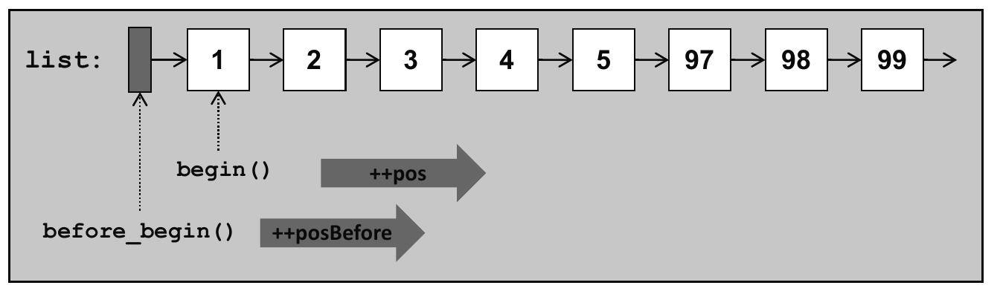
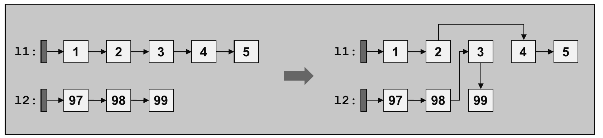

# 7.6.2–7.6.4 · Tìm kiếm và chuyển phần tử trong `forward_list`

> **Nguồn:** Nicolai M. Josuttis, *The C++ Standard Library*, ấn bản thứ hai, trang 308–313 (PDF trang 337–342). Hình được cắt từ sách; phần đính chính được ghi rõ.

## Tìm vị trí đứng trước



*Hình 7.10 trong sách: một iterator đi trước iterator còn lại một vị trí.*

Sách giới thiệu hai thuật toán tự viết: `find_before` tìm vị trí trước giá trị cần tìm, còn `find_before_if` tìm vị trí trước phần tử thỏa predicate. Cả hai nhận vị trí bắt đầu và vị trí kết thúc:

```cpp
template <typename ForwardIterator, typename T>
ForwardIterator find_before(ForwardIterator first, ForwardIterator last, const T& value) {
    if (first == last) return first;
    auto next = first;
    ++next;
    while (next != last && !(*next == value)) {
        ++next;
        ++first;
    }
    return first;
}

template <typename ForwardIterator, typename Pred>
ForwardIterator find_before_if(ForwardIterator first, ForwardIterator last, Pred pred) {
    if (first == last) return first;
    auto next = first;
    ++next;
    while (next != last && !pred(*next)) {
        ++next;
        ++first;
    }
    return first;
}
```

Dùng `find_before_if(values.before_begin(), values.end(), predicate)` để xét cả phần tử đầu. Nếu truyền `begin()`, thuật toán bắt đầu xét từ phần tử thứ hai. Nếu không tìm thấy, hàm trả vị trí đứng trước `end()`; với list rỗng, kết quả là `before_begin()`. Do vậy, trước khi xóa hoặc chuyển phần tử sau kết quả, phải kiểm tra `std::next(result) != values.end()`.

Sách đặt tên tham số kiểu là `InputIterator`, nhưng thuật toán giữ và tăng hai bản sao iterator độc lập; để dùng tổng quát, cần iterator hỗ trợ duyệt nhiều lượt, như forward iterator của `forward_list`. Với container này, không dereference `before_begin()`; chỉ dereference iterator kế tiếp sau khi đã kiểm tra khác `end()`.

## Chuyển phần tử và đổi thứ tự



*Hình 7.11 trong sách: minh họa thay liên kết khi chuyển phần tử.*

| Thao tác | Ý nghĩa |
|:---|:---|
| `c.unique()` / `c.unique(pred)` | Xóa phần tử trùng liền kề theo phép so sánh hoặc predicate. |
| `c.splice_after(pos, other)` | Chuyển toàn bộ `other` vào sau `pos`. |
| `c.splice_after(pos, other, before)` | Chuyển phần tử **sau** `before` trong `other` vào sau `pos`. |
| `c.splice_after(pos, other, before, last)` | Chuyển khoảng mở `(before,last)` vào sau `pos`. |
| `c.sort()` / `c.sort(comp)` | Sắp xếp bằng thứ tự mặc định hoặc comparator. |
| `c.merge(other)` / `c.merge(other,comp)` | Trộn hai danh sách đã sắp theo cùng tiêu chí. |
| `c.reverse()` | Đảo thứ tự. |

Iterator và tham chiếu tới phần tử được chuyển vẫn hợp lệ, nhưng phần tử nay thuộc container đích. Khi chuyển giữa hai container, allocator phải phù hợp theo tiền điều kiện của thao tác; khi nguồn và đích trùng nhau, cần tuân thủ quy tắc riêng của overload. Không dùng `end()` làm vị trí đích cho thao tác `_after`.

Để chuyển số 3 từ `l1` sang trước số 99 trong `l2`, trước tiên tìm nút đứng trước từng giá trị. Đoạn sau dùng `find_before` phía trên:

```cpp
std::forward_list<int> l1{1, 2, 3, 4, 5};
std::forward_list<int> l2{97, 98, 99};
auto before3 = find_before(l1.before_begin(), l1.end(), 3);
auto before99 = find_before(l2.before_begin(), l2.end(), 99);
if (std::next(before3) != l1.end() && std::next(before99) != l2.end()) {
    l2.splice_after(before99, l1, before3);
}
// l1: 1 2 4 5
// l2: 97 98 3 99
```

:::note Đính chính ví dụ sách
Trang 310 gọi `l1.splice_after(pos2, l2, pos1)` dù `pos2` thuộc `l2` và `pos1` thuộc `l1`. Iterator không thuộc đúng container tương ứng nên lời gọi đó vi phạm tiền điều kiện. Lời gọi đúng là `l2.splice_after(pos2, l1, pos1)`. Trang 311 còn minh họa `find_before` như một hàm thành viên, nhưng các hàm được định nghĩa ở trang 308 là hàm tự do, không phải thành viên `forward_list`.
:::

## 7.6.3 Ngoại lệ

Theo sách, `forward_list` có cùng loại bảo đảm xử lý ngoại lệ như `list` đối với các thao tác tương ứng. Xem phần list để xét điều kiện của allocator, comparator và từng overload; không suy ra mọi thao tác đều có bảo đảm hoàn tác khi comparator hoặc phép gán ném ngoại lệ.

## 7.6.4 Ví dụ tổng hợp

Ví dụ sau giữ các thao tác và kết quả của sách: chèn ở đầu, chép phạm vi, xóa sau một vị trí, sắp xếp, loại trùng liền kề và trộn.

```cpp
#include <algorithm>
#include <forward_list>
#include <iostream>
#include <iterator>
#include <string>

void printLists(const std::string& label, const std::forward_list<int>& a,
                const std::forward_list<int>& b) {
    std::cout << label << "\n list1: ";
    std::copy(a.cbegin(), a.cend(), std::ostream_iterator<int>(std::cout, " "));
    std::cout << "\n list2: ";
    std::copy(b.cbegin(), b.cend(), std::ostream_iterator<int>(std::cout, " "));
    std::cout << '\n';
}

int main() {
    std::forward_list<int> list1{1, 2, 3, 4};
    std::forward_list<int> list2{77, 88, 99};
    printLists("initial:", list1, list2);

    list2.insert_after(list2.before_begin(), 99);
    list2.push_front(10);
    list2.insert_after(list2.before_begin(), {10, 11, 12, 13});
    printLists("6 new elems:", list1, list2);

    list1.insert_after(list1.before_begin(), list2.begin(), list2.end());
    printLists("list2 into list1:", list1, list2);
    list2.erase_after(list2.begin());
    list2.erase_after(std::find(list2.begin(), list2.end(), 99), list2.end());
    printLists("delete 2nd and after 99:", list1, list2);

    list1.sort();
    list2 = list1;
    list2.unique();
    printLists("sorted and unique:", list1, list2);
    list1.merge(list2);
    printLists("merged:", list1, list2);
}
```

Sau xóa, `list2` là `10 12 13 10 99`. Sau trộn, `list2` rỗng và `list1` là `1 1 2 2 3 3 4 4 10 10 10 11 11 12 12 13 13 77 77 88 88 99 99 99`. Trong ví dụ này chắc chắn có giá trị 99; với dữ liệu bất kỳ phải kiểm tra kết quả `find` khác `end()` trước khi dùng làm vị trí xóa.
