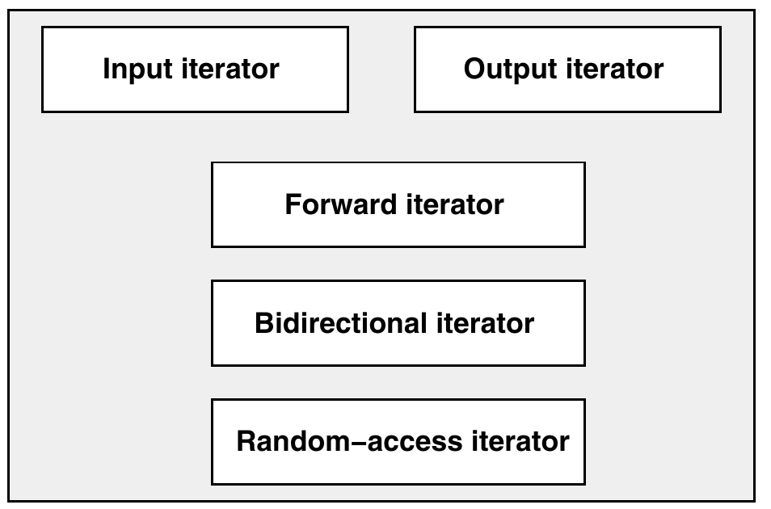
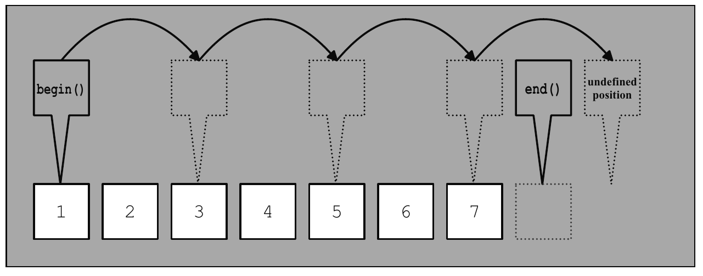

# 9.1–9.2 · Phân loại iterator

> **Nguồn:** Nicolai M. Josuttis, *The C++ Standard Library*, ấn bản thứ hai, trang 433–441 (PDF trang 462–470). Hình được cắt từ sách; các ghi chú hiện đại được phân biệt trong nội dung.

## 9.1 Header

Container định nghĩa kiểu iterator của nó trong header container. Khi dùng tiện ích và iterator adapter như `std::next`, `std::advance`, `std::reverse_iterator` hoặc stream iterator, hãy include `<iterator>` trực tiếp; không dựa vào một header khác tình cờ include nó.

## 9.2 Các nhóm iterator

Iterator cung cấp giao diện kiểu con trỏ để thuật toán làm việc với nhiều cấu trúc dữ liệu. Mỗi thuật toán có yêu cầu tối thiểu về khả năng iterator: ví dụ `std::sort` cần random access. Iterator đọc được và đồng thời đáp ứng yêu cầu ghi tương ứng được sách gọi là *mutable*.



*Hình 9.1 trong sách: các nhóm iterator của mô hình STL truyền thống.*

| Nhóm | Khả năng chính | Ví dụ |
|:---|:---|:---|
| Output | Ghi khi tiến. | `ostream_iterator`, inserter. |
| Input | Đọc khi tiến; có thể chỉ duyệt được một lượt. | `istream_iterator`. |
| Forward | Đọc tiến với bảo đảm nhiều lượt; có thể ghi nếu iterator hỗ trợ. | `forward_list`, unordered container. |
| Bidirectional | Các khả năng forward cộng với đi lùi. | `list`, set/map có thứ tự. |
| Random access | Các khả năng bidirectional cộng số học và truy cập theo độ lệch. | `array`, vector thông thường, deque, string, con trỏ mảng C. |

Đây là các nhóm *legacy iterator* theo sách C++11. C++20 còn có iterator concepts, sentinel và nhóm contiguous; khi dùng ranges cần kiểm tra yêu cầu concept của thuật toán tương ứng.

### 9.2.1 Output iterator

Output iterator hỗ trợ mô hình ghi tuần tự `*it = value; ++it;` hoặc biểu thức ghi phù hợp. Có thể sao chép và tăng iterator, nhưng không được giả định có thể đọc lại, đi lùi, so sánh mọi output iterator, hay ghi hai lần vào cùng một vị trí. `ostream_iterator` ghi ra stream; inserter biến phép gán thành thao tác chèn.

Một const iterator của container không cho phép sửa phần tử qua nó, nên không đáp ứng nhu cầu ghi phần tử của output iterator. Việc ghi ra stream vẫn có thể thất bại; trạng thái lỗi được kiểm tra qua stream, không phải một khả năng so sánh bắt buộc của output iterator.

### 9.2.2 Input iterator

Input iterator hỗ trợ đọc `*it`, truy cập thành viên khi phù hợp, tăng và so sánh trong miền hợp lệ. Nó có thể chỉ hỗ trợ **một lượt**: sao chép iterator rồi tiến một bản không bảo đảm bản còn lại giữ được một lượt duyệt độc lập. `istream_iterator` minh họa việc đọc tuần tự từ stream.

```cpp
#include <algorithm>
#include <iostream>
#include <iterator>

int main() {
    std::copy(std::istream_iterator<int>(std::cin), std::istream_iterator<int>(),
              std::ostream_iterator<int>(std::cout, " "));
}
```

Sách khuyên ưu tiên `++it` khi không cần giá trị cũ, vì `it++` có thể phải tạo bản sao. Đây là quy tắc diễn đạt ý định hữu ích, không phải bảo đảm postincrement luôn chậm hơn: compiler có thể tối ưu và chi phí phụ thuộc kiểu iterator.

### 9.2.3 Forward và 9.2.4 bidirectional

Forward iterator bổ sung bảo đảm *multi-pass*: các bản sao hợp lệ có thể được dùng để duyệt độc lập, và hai iterator cùng vị trí khi cùng tăng theo quy tắc sẽ tới cùng vị trí tiếp theo. Nó hỗ trợ default construction, sao chép, gán và so sánh theo yêu cầu của nhóm. `forward_list` và unordered container cung cấp tối thiểu loại này.

Bidirectional iterator bổ sung `--it` và `it--`. `list` và các set/map có thứ tự cung cấp nhóm này. Chỉ giảm iterator khi có vị trí trước hợp lệ: với container không rỗng, có thể giảm `end()`; không được giảm `begin()`.

### 9.2.5 Random access

Random-access iterator hỗ trợ `it[n]`, `it += n`, `it -= n`, `it + n`, `it - n`, hiệu giữa iterator và các phép so sánh thứ tự hợp lệ trong cùng phạm vi. Các phép tính phải ở trong miền cho phép của cùng dãy, bao gồm vị trí sau cuối; không tạo vị trí trước đầu hoặc vượt quá sau cuối.



*Hình 9.2 trong sách: tăng hai bước với số phần tử lẻ có thể vượt quá vị trí sau cuối.*

Sách minh họa vector từ -3 đến 9, hiệu `end() - begin()` là 13 và `begin()[i]` truy cập theo độ lệch. Một vòng lặp `it += 2` không được tạo iterator vượt `end()` ở lần tăng cuối. Ví dụ an toàn sau kiểm tra khoảng còn lại:

```cpp
#include <iostream>
#include <vector>

int main() {
    std::vector<int> values{-3, -2, -1, 0, 1, 2, 3, 4, 5, 6, 7, 8, 9};
    std::cout << "number/distance: " << values.end() - values.begin() << '\n';
    for (auto it = values.begin(); it != values.end();) {
        std::cout << *it << ' ';
        if (values.end() - it <= 2) break;
        it += 2;
    }
    std::cout << '\n'; // -3 -1 1 3 5 7 9
}
```

Vòng lặp ví dụ trong sách dừng trước phần tử cuối và in tới 7; phiên bản trên chủ ý in mọi phần tử ở vị trí chẵn, kể cả 9, và cũng xử lý vector rỗng. Không tính `end()-1` trước khi biết dãy không rỗng.

### 9.2.6 Tăng iterator tạm

`++coll.begin()` không portable: nếu iterator là raw pointer, không thể áp dụng `++` cho giá trị pointer tạm theo cách đó; nếu là class, việc biên dịch còn phụ thuộc phép toán được cung cấp. Từ C++11, dùng `std::next(coll.begin())` sau khi bảo đảm có thể tiến một bước; hoặc lưu `auto it = coll.begin(); ++it;`. `std::sort` vẫn yêu cầu random access và phạm vi hợp lệ.
