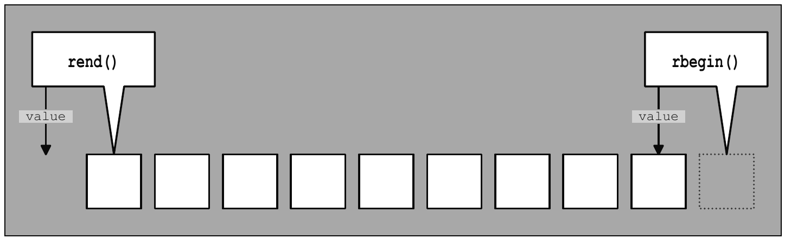
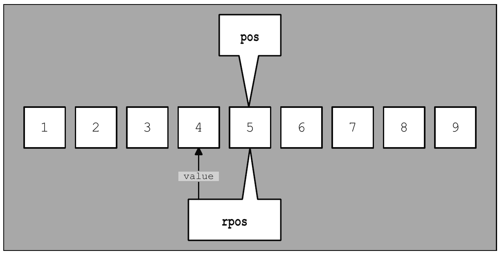

# 9.4.1 · Reverse iterator

> **Nguồn:** Nicolai M. Josuttis, *The C++ Standard Library*, ấn bản thứ hai, trang 448–453 (PDF trang 477–482). Hình được cắt từ sách.

Iterator adapter biến đổi cách một iterator hoạt động để thuật toán có thể duyệt ngược, chèn phần tử hoặc làm việc với stream. Reverse iterator biến `++` thành tiến theo chiều ngược so với iterator nền.

## Duyệt ngược

Các container có bidirectional iterator phù hợp cung cấp `rbegin()` và `rend()`; `forward_list` và unordered container không có các hàm thành viên đó. `crbegin()` và `crend()` trả iterator ngược chỉ đọc từ C++11.

```cpp
#include <algorithm>
#include <iostream>
#include <list>

void print(int value) { std::cout << value << ' '; }
int main() {
    std::list<int> values{1, 2, 3, 4, 5, 6, 7, 8, 9};
    std::for_each(values.cbegin(), values.cend(), print);
    std::cout << '\n';
    std::for_each(values.crbegin(), values.crend(), print);
    std::cout << '\n';
}
```

Hai dòng kết quả là `1 2 3 4 5 6 7 8 9` và `9 8 7 6 5 4 3 2 1`. Phạm vi reverse vẫn là nửa mở `[rbegin,rend)`; không dereference `rend()`.

## Vị trí nền và giá trị được đọc



*Hình 9.3 trong sách: liên hệ giữa hai đầu phạm vi xuôi và phạm vi ngược.*

Reverse iterator lưu một iterator nền. Khi `r` có thể dereference, `*r` tương ứng `*std::prev(r.base())`: giá trị được đọc nằm **trước** vị trí nền một bước. Quy ước này cho phép `rbegin().base() == end()` và `rend().base() == begin()` mà không cần tạo iterator xuôi trỏ trước đầu container.



*Hình 9.4 trong sách: chuyển iterator nền tại 5 thành reverse iterator đọc 4.*

Nếu `pos` trỏ tới 5 trong dãy 1–9, `std::reverse_iterator<It> rpos(pos)` đọc 4, còn `rpos.base()` trả lại `pos` trỏ tới 5. Không dereference `reverse_iterator(begin())`, vì iterator nền không có phần tử trước nó; tương tự, `*rbegin().base()` không hợp lệ vì base là `end()`.

## Đảo chiều một phạm vi

Phạm vi xuôi `[first,last)` tương ứng phạm vi ngược `[reverse_iterator(last), reverse_iterator(first))`. Hai phạm vi chứa cùng phần tử theo thứ tự ngược nhau:

```cpp
#include <algorithm>
#include <deque>
#include <iostream>
#include <iterator>

int main() {
    std::deque<int> values{1, 2, 3, 4, 5, 6, 7, 8, 9};
    auto first = std::find(values.cbegin(), values.cend(), 2);
    auto last = std::find(values.cbegin(), values.cend(), 7);
    if (first == values.cend() || last == values.cend() || first > last) return 1;
    std::copy(first, last, std::ostream_iterator<int>(std::cout, " "));
    std::cout << '\n';
    using Rev = std::deque<int>::const_reverse_iterator;
    std::copy(Rev(last), Rev(first), std::ostream_iterator<int>(std::cout, " "));
    std::cout << '\n';
}
```

Kết quả: `2 3 4 5 6` rồi `6 5 4 3 2`. Kiểm tra `first > last` trong ví dụ hợp lệ vì iterator deque là random access và cùng container; không áp dụng phép `>` đó cho iterator list. Từ C++14 có thể dùng `std::make_reverse_iterator` để suy ra kiểu.

## Dùng `base()` khi cần iterator xuôi

`base()` trả iterator nền, tức vị trí **sau** phần tử mà reverse iterator đang đọc. Khi cần xóa phần tử được tìm bằng reverse iterator, phải chuyển về đúng vị trí:

```cpp
#include <algorithm>
#include <iterator>
#include <vector>

int main() {
    std::vector<int> values{1, 2, 3, 2, 1};
    auto rpos = std::find(values.rbegin(), values.rend(), 2);
    if (rpos != values.rend()) values.erase(std::prev(rpos.base()));
    return values == std::vector<int>{1, 2, 3, 1} ? 0 : 1;
}
```

Phải kiểm tra `rpos != rend()` trước khi giảm base; sau `erase`, các iterator có thể mất hiệu lực theo quy tắc của vector.
