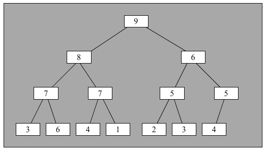

# 11.9.4–11.10.1 · Heap và tìm kiếm trên phạm vi đã sắp

> **Nguồn:** Nicolai M. Josuttis, *The C++ Standard Library*, ấn bản thứ hai, trang 604–609 (PDF trang 633–638). Hình được cắt từ sách.

## Heap

Heap là cách tổ chức một phạm vi random-access sao cho quan hệ cha–con thỏa comparator. Với thứ tự mặc định, không nút con nào lớn hơn nút cha và phần tử đầu là một maximum nếu heap không rỗng. Không có yêu cầu toàn bộ dãy được sắp xếp.



*Hình 11.1 trong sách: một heap biểu diễn thành cây nhị phân.*

| Thuật toán | Công dụng và tiền điều kiện |
|:---|:---|
| `make_heap(first,last[,comp])` | Tạo heap từ phạm vi random-access; tuyến tính theo số phần tử. |
| `push_heap(first,last[,comp])` | Đưa phần tử cuối vào heap đã có ở `[first,last-1)`; phạm vi phải hợp lệ, không rỗng và tiền tố đã là heap. |
| `pop_heap(first,last[,comp])` | Chuyển phần tử đầu ưu tiên ra vị trí cuối và khôi phục heap trên `[first,last-1)`; nguồn phải là heap không rỗng. |
| `sort_heap(first,last[,comp])` | Sắp xếp phạm vi đã là heap theo cùng comparator; kết quả không còn được bảo đảm là heap. |
| `is_heap`, `is_heap_until` | Kiểm tra tính chất heap hoặc tìm vị trí đầu phá vỡ tính chất. |

`push_heap` và `pop_heap` không thay kích thước container. Muốn thêm, trước tiên thêm phần tử bằng `push_back`, rồi gọi `push_heap`; muốn loại phần tử ưu tiên, gọi `pop_heap` rồi `pop_back`. `push_heap`/`pop_heap` có độ phức tạp so sánh logarithmic; `make_heap` tuyến tính và `sort_heap` bậc `N log N` theo hợp đồng tương ứng.

```cpp
#include <algorithm>
#include <cassert>
#include <vector>

int main() {
    std::vector<int> values{3,4,5,6,7,5,6,7,8,9,1,2,3,4};
    std::make_heap(values.begin(), values.end());
    assert(std::is_heap(values.begin(), values.end()) && values.front() == 9);
    std::pop_heap(values.begin(), values.end());
    assert(values.back() == 9);
    values.pop_back();
    values.push_back(17);
    std::push_heap(values.begin(), values.end());
    assert(values.front() == 17 && std::is_heap(values.begin(), values.end()));
    std::sort_heap(values.begin(), values.end());
    assert(std::is_sorted(values.begin(), values.end()));
    assert((values == std::vector<int>{1,2,3,3,4,4,5,5,6,6,7,7,8,17}));
}
```

Cấu hình heap trung gian có thể khác output minh họa trong sách; kiểm tra bất biến thay vì đòi một cách sắp nội bộ duy nhất. Dùng cùng comparator cho các thao tác trên một heap. `std::priority_queue`, trình bày ở chương 12, đóng gói giao diện hàng đợi ưu tiên dựa trên các ý tưởng này.

### Heap với phần tử nhỏ nhất ở đầu

Thay comparator bằng `std::greater<int>` để phần tử nhỏ nhất nằm ở đầu. Khi thêm hoặc lấy phần tử, phải tiếp tục truyền comparator đó:

```cpp
#include <algorithm>
#include <cassert>
#include <functional>
#include <vector>

int main() {
    std::vector<int> values{7, 2, 5, 3};
    const std::greater<int> comp;
    std::make_heap(values.begin(), values.end(), comp);
    assert(std::is_heap(values.begin(), values.end(), comp));
    assert(values.front() == 2);

    values.push_back(1);
    std::push_heap(values.begin(), values.end(), comp);
    assert(values.front() == 1);
    std::pop_heap(values.begin(), values.end(), comp);
    assert(values.back() == 1); // vẫn còn trong vector
    values.pop_back();
    assert(values.front() == 2);

    const std::vector<int> notHeap{9, 7, 8, 10};
    auto broken = std::is_heap_until(notHeap.begin(), notHeap.end());
    assert(broken == notHeap.begin() + 3);
}
```

`is_heap_until` trả iterator đầu tiên làm tiền tố không còn là heap, hoặc `end()` nếu toàn bộ phạm vi thỏa mãn. Ví dụ `notHeap` dùng comparator mặc định, nên `10` vi phạm quan hệ max-heap với nút cha. Không dereference kết quả khi nó bằng `end()`.

## 11.10.1 `binary_search`

`std::binary_search(first,last,value[,comp])` kiểm tra có phần tử tương đương theo quan hệ thứ tự hay không; nó trả `bool`, không trả vị trí. Dùng `lower_bound`, `upper_bound` hoặc `equal_range` nếu cần iterator. Một phạm vi được sắp theo cùng comparator là điều kiện thông dụng bảo đảm tính phân vùng cần thiết; không dựa vào kết quả khi vi phạm tiền điều kiện của overload.

```cpp
#include <algorithm>
#include <cassert>
#include <list>

int main() {
    std::list<int> values{1,2,3,4,5,6,7,8,9};
    assert(std::binary_search(values.cbegin(), values.cend(), 5));
    assert(!std::binary_search(values.cbegin(), values.cend(), 42));
}
```

Số phép so sánh là logarithmic, nhưng với iterator không random access như list, tổng số bước di chuyển iterator có thể tuyến tính. Với set/map, hàm thành viên tìm kiếm thường tận dụng cấu trúc container tốt hơn thuật toán tổng quát qua bidirectional iterator. Các thuật toán tìm cận và phép tập hợp được tiếp tục ở phần sau.
