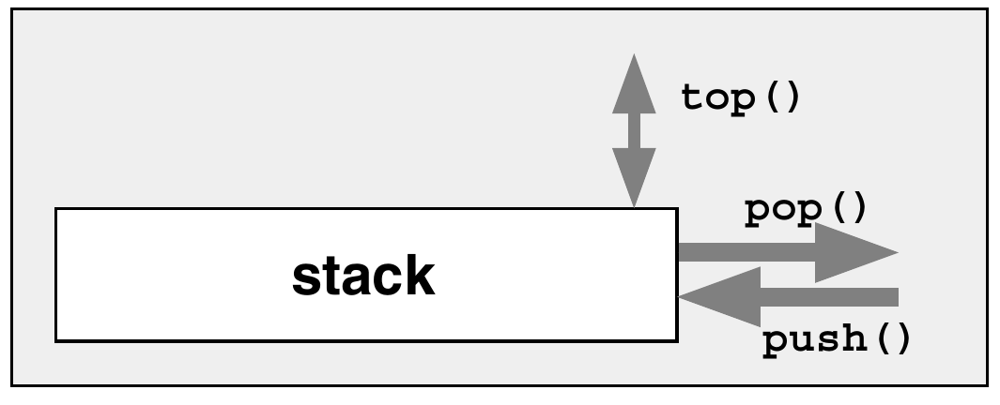
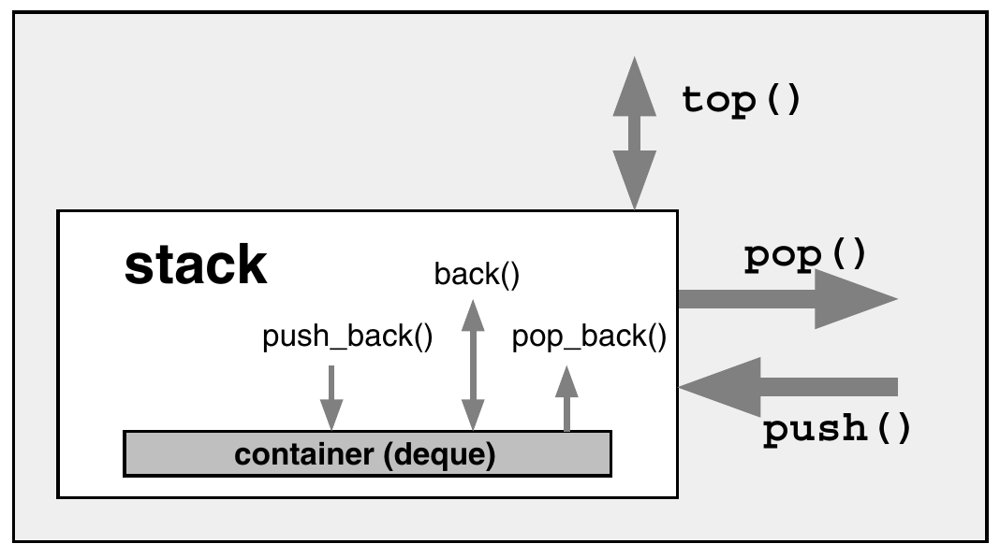

# 12.1 · `std::stack`

> **Nguồn:** Nicolai M. Josuttis, *The C++ Standard Library*, ấn bản thứ hai, trang 631–637 (PDF trang 660–666). Hình được cắt từ sách.

Chương 12 giới thiệu ba container adapter `stack`, `queue`, `priority_queue` và `bitset`. Adapter dùng một container nền để cung cấp giao diện giới hạn theo nhu cầu; `bitset<N>` lưu số bit cố định. `vector<bool>` có kích thước động và được bàn ở chương 7.

## Stack và LIFO

`std::stack` dùng quy tắc *last in, first out*: phần tử đưa vào sau cùng được lấy ra trước.



*Hình 12.1 trong sách: giao diện stack.*

Include `<stack>` và dùng `std::stack<T, Container>`. Container nền mặc định là `std::deque<T>`; vector và list cũng có thể được dùng khi đáp ứng các yêu cầu. `top`, `push`, `pop` tương ứng các thao tác ở cuối container nền.



*Hình 12.2 trong sách: ánh xạ thao tác xuống container nền.*

Sách nhận xét deque giải phóng bộ nhớ khi xóa; chuẩn không bảo đảm bộ nhớ được trả về hệ điều hành tại thời điểm đó. Lựa chọn container nền ảnh hưởng hiệu năng và invalidation; cần xét workload thực tế.

| Thao tác | Ý nghĩa |
|:---|:---|
| `push(value)` | Thêm phần tử ở đỉnh, bằng copy hoặc move theo overload. |
| `emplace(args...)` | Dựng phần tử mới ở đỉnh từ đối số. |
| `top()` | Truy cập phần tử đỉnh; không xóa. |
| `pop()` | Xóa phần tử đỉnh; không trả giá trị. |
| `empty()`, `size()` | Kiểm tra rỗng hoặc số phần tử. |

`top()` và `pop()` yêu cầu stack không rỗng; kiểm tra `empty()` trước khi dùng. Tách đọc và xóa cho phép bỏ phần tử mà không cần tạo bản sao, và giúp caller kiểm soát khi copy/move giá trị có thể ném ngoại lệ.

## Ví dụ trong sách

```cpp
#include <cassert>
#include <stack>
#include <vector>

int main() {
    std::stack<int> st;
    st.push(1); st.push(2); st.push(3);
    std::vector<int> output;
    output.push_back(st.top()); st.pop();
    output.push_back(st.top()); st.pop();
    st.top() = 77;
    st.push(4); st.push(5);
    st.pop();
    while (!st.empty()) { output.push_back(st.top()); st.pop(); }
    assert((output == std::vector<int>{3,2,4,77}));
}
```

Kết quả tương ứng `3 2 4 77`. Với kiểu phức tạp, `push(std::move(value))` có thể chuyển giá trị và `emplace(args...)` chuyển đối số để dựng phần tử; cần tuân thủ trạng thái sau move của kiểu nguồn.

## 12.1.3 Stack tự viết có kiểm tra rỗng

Sách minh họa một lớp bao `deque` mà `pop()` trả giá trị và cả `top()` lẫn `pop()` ném ngoại lệ khi rỗng. Dưới đây giữ ý tưởng đó, với ngoại lệ chuẩn để ví dụ tự đủ:

```cpp
#include <cassert>
#include <deque>
#include <stdexcept>

template<class T>
class CheckedStack {
    std::deque<T> values_;
public:
    bool empty() const { return values_.empty(); }
    typename std::deque<T>::size_type size() const { return values_.size(); }
    void push(const T& value) { values_.push_back(value); }
    T& top() {
        if (empty()) throw std::out_of_range("read empty stack");
        return values_.back();
    }
    T pop() {
        if (empty()) throw std::out_of_range("read empty stack");
        T result(values_.back());
        values_.pop_back();
        return result;
    }
};

int main() {
    CheckedStack<int> st;
    st.push(1); st.push(2);
    assert(st.pop() == 2 && st.pop() == 1);
    try { st.pop(); assert(false); }
    catch (const std::out_of_range&) {}
}
```

Sách định nghĩa kiểu ngoại lệ riêng `ReadEmptyStack` kế thừa `std::exception`, với `what()` trả `read empty stack`. Khi gọi pop thêm một lần, chương trình bắt ngoại lệ và in thông báo đó. Ví dụ wrapper trên copy phần tử trước khi xóa và cần kiểu có thể copy; trả giá trị có thể liên quan thêm thao tác move/copy và ngoại lệ. Đó là một trade-off cần thiết kế theo yêu cầu, không phải thay thế mặc định cho mọi `std::stack`.

Trong ví dụ trên, nếu constructor sao chép `T result(values_.back())` ném ngoại lệ, `pop_back()` chưa được gọi và phần tử vẫn nằm trong deque. Tuy nhiên, nếu việc chuyển hoặc sao chép giá trị trả về ném **sau** `pop_back()`, phần tử đã bị xóa. Vì vậy không nên hứa bảo đảm rằng mọi ngoại lệ của `pop()` đều giữ nguyên stack.

Nếu chỉ cần đọc rồi xóa riêng, dùng `top()` và `pop()` của `std::stack` giúp caller quyết định khi nào xóa. Ví dụ với phần tử có thể sao chép:

```cpp
#include <cassert>
#include <stack>
#include <string>

int main() {
    std::stack<std::string> messages;
    messages.push("hello");
    if (!messages.empty()) {
        std::string saved = messages.top(); // sao chép trước khi xóa
        messages.pop();
        assert(saved == "hello");
    }
    assert(messages.empty());
}
```

Nếu sao chép vào `saved` thất bại, lời gọi `pop()` chưa xảy ra. Với kiểu chỉ hỗ trợ move, cần cân nhắc ngoại lệ và trạng thái phần tử nguồn theo hợp đồng của kiểu đó trước khi chọn chiến lược lấy giá trị.
