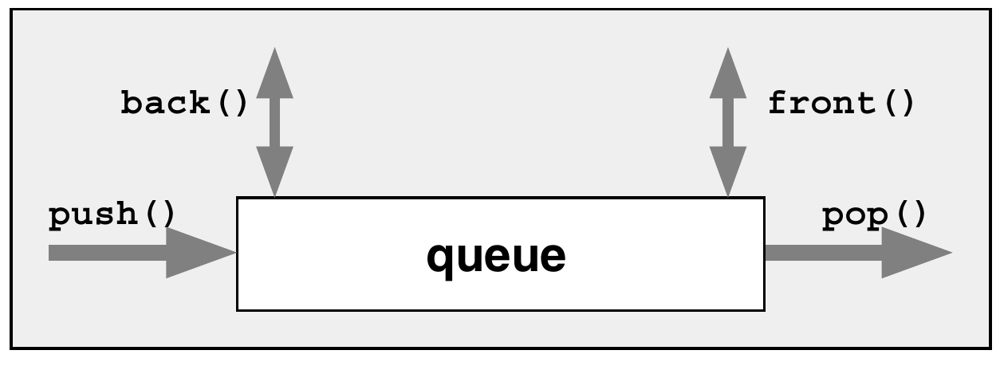
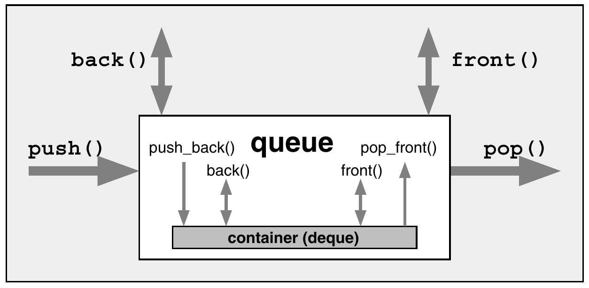
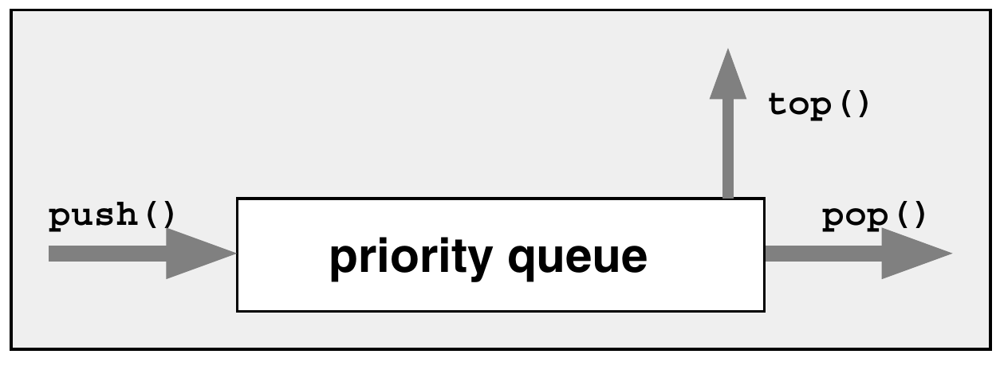

Phần này theo mục 12.2–12.3 của sách, trang 638–645: hàng đợi FIFO và hàng đợi ưu tiên. Cả hai được khai báo trong `<queue>`.

## Queue: vào trước, ra trước

`std::queue` là hàng đợi **FIFO**: phần tử được thêm trước sẽ được lấy ra trước. Nó có thể dùng làm bộ đệm dữ liệu.



*Hình 12.3 trong sách: thêm ở phía `back`, lấy ra ở phía `front`.*

```cpp
#include <queue>
#include <string>
#include <list>

std::queue<std::string> buffer; // container nền mặc định: deque
std::queue<std::string, std::list<std::string>> listBuffer;
```

Tham số template đầu là kiểu phần tử, tham số thứ hai là container nền. Theo sách, container nền cần hỗ trợ `front()`, `back()`, `push_back()` và `pop_front()`; `deque` và `list` đáp ứng yêu cầu này.



*Hình 12.4 trong sách: ví dụ ánh xạ queue xuống deque.*

| Thao tác | Ý nghĩa |
| --- | --- |
| `push(x)` | Thêm `x` vào cuối hàng đợi. |
| `front()` | Truy cập phần tử ở đầu, được thêm sớm nhất trong các phần tử còn lại. |
| `back()` | Truy cập phần tử ở cuối, được thêm gần nhất. |
| `pop()` | Xóa phần tử ở đầu; không trả về phần tử đó. |
| `empty()`, `size()` | Kiểm tra rỗng và số phần tử. |

Để xử lý rồi xóa phần tử đầu, gọi `front()` trước và `pop()` sau. `front()`, `back()` và `pop()` có hành vi không xác định khi hàng đợi rỗng; kiểm tra `empty()` trước nếu chưa biết chắc.

### Ví dụ FIFO

```cpp
#include <iostream>
#include <queue>
#include <string>

int main() {
    std::queue<std::string> q;
    q.push("These ");
    q.push("are ");
    q.push("more than ");

    std::cout << q.front(); q.pop();
    std::cout << q.front(); q.pop();
    q.push("four ");
    q.push("words!");
    q.pop(); // bỏ qua "more than "
    std::cout << q.front(); q.pop();
    std::cout << q.front() << '\n'; q.pop();
    std::cout << "number of elements in the queue: " << q.size() << '\n';
}
```

Kết quả:

```text
These are four words!
number of elements in the queue: 0
```

Sách cũng đề cập có thể tự xây dựng giao diện thuận tiện và an toàn hơn, tương tự lớp stack tự viết ở mục 12.1.3; ví dụ `Queue.hpp` và `queue2.cpp` được cung cấp trên trang web của sách. Các thao tác chi tiết của adapter được trình bày ở mục 12.4.

## Priority queue: lấy theo độ ưu tiên

`std::priority_queue` cung cấp phần tử có độ ưu tiên cao nhất trước, không theo thứ tự thêm vào. Mặc định nó dùng `std::less`, nên phần tử lớn nhất theo `operator<` nằm ở `top()`. Nếu có nhiều phần tử cùng ưu tiên cao nhất, thứ tự lấy giữa chúng không được đảm bảo.



*Hình 12.5 trong sách: `push`, `top` và `pop`.*

```cpp
#include <queue>
#include <vector>
#include <deque>
#include <functional>

std::priority_queue<float> maxQueue; // vector, std::less
std::priority_queue<float, std::deque<float>> dequeQueue;
std::priority_queue<float, std::vector<float>, std::greater<float>> minQueue;
```

Tham số thứ nhất là kiểu phần tử; thứ hai là container nền (mặc định `vector`); thứ ba là tiêu chí so sánh (mặc định `less`). Với `greater`, phần tử nhỏ nhất được lấy trước. Có thể dùng function object, hàm hoặc lambda làm tiêu chí so sánh thích hợp. Container nền cần random-access iterator và các thao tác `front()`, `push_back()`, `pop_back()`; sách nêu `deque` là một lựa chọn khác.

`push()` thêm phần tử, `top()` truy cập phần tử ưu tiên cao nhất, còn `pop()` xóa phần tử đó mà không trả về nó. `top()` và `pop()` trên hàng đợi rỗng có hành vi không xác định; dùng `empty()` hoặc `size()` để kiểm tra.

### Ví dụ ưu tiên mặc định

```cpp
#include <iostream>
#include <queue>

int main() {
    std::priority_queue<float> q;
    q.push(66.6f); q.push(22.2f); q.push(44.4f);
    std::cout << q.top() << ' '; q.pop();
    std::cout << q.top() << '\n'; q.pop();
    q.push(11.1f); q.push(55.5f); q.push(33.3f);
    q.pop(); // bỏ 55.5, phần tử ưu tiên cao nhất lúc này
    while (!q.empty()) {
        std::cout << q.top() << ' ';
        q.pop();
    }
    std::cout << '\n';
}
```

```text
66.6 44.4
33.3 22.2 11.1
```

Sau hai lần lấy đầu tiên, `22.2` còn lại. Thêm ba số mới rồi gọi `pop()` sẽ bỏ `55.5`; vòng lặp sau đó lấy các giá trị còn lại theo thứ tự ưu tiên giảm dần.

### Đặt tiêu chí ưu tiên cho đối tượng

Comparator của `priority_queue` trả `true` khi đối số đầu được xếp **trước** đối số sau theo quan hệ thứ tự; `top()` trả phần tử cuối theo quan hệ đó. Vì vậy với `std::less`, phần tử lớn nhất ở trên cùng. Có thể thêm khóa phụ nếu cần quy tắc rõ ràng cho các công việc có cùng mức ưu tiên:

```cpp
#include <cassert>
#include <queue>
#include <vector>

struct Job {
    int priority;
    int sequence;
};

struct LowerPriority {
    bool operator()(const Job& a, const Job& b) const {
        if (a.priority != b.priority) return a.priority < b.priority;
        return a.sequence > b.sequence; // sequence nhỏ hơn được lấy trước
    }
};

int main() {
    std::priority_queue<Job, std::vector<Job>, LowerPriority> jobs;
    jobs.push({2, 10});
    jobs.push({5, 11});
    jobs.push({5, 12});
    assert(jobs.top().sequence == 11); jobs.pop();
    assert(jobs.top().sequence == 12); jobs.pop();
    assert(jobs.top().sequence == 10); jobs.pop();
    assert(jobs.empty());
}
```

Quy tắc này ưu tiên số `priority` lớn hơn, rồi số `sequence` nhỏ hơn. Nếu hai phần tử bằng nhau theo cả hai khóa, thứ tự giữa chúng vẫn không được đảm bảo. Comparator cần thiết lập thứ tự yếu chặt và không nên phụ thuộc vào dữ liệu thay đổi trong khi phần tử đang nằm trong heap.

### Cách hoạt động với heap

Sách minh họa `priority_queue` bằng container `c` và comparator `comp`: constructor tạo heap với `make_heap(c.begin(), c.end(), comp)`; `push` gọi `c.push_back(x)` rồi `push_heap`; `pop` gọi `pop_heap` rồi `c.pop_back()`; `top()` trả về `c.front()` dưới dạng tham chiếu chỉ đọc. Đây là cách nhìn theo các thuật toán heap của STL, không có nghĩa toàn bộ container được sắp xếp hoàn chỉnh. Khác với các container adapter còn lại, `priority_queue` không có toán tử so sánh theo nội dung trong giao diện được sách mô tả.
