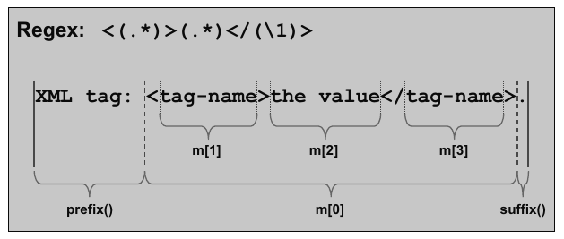

Chương 14 giới thiệu thư viện `<regex>` từ C++11: kiểm tra toàn bộ đầu vào, tìm đoạn khớp, tách token và thay thế theo mẫu. Mẫu được hiểu theo một grammar được chọn. Phần này theo mục 14.1–14.2, trang 717–724.

## Match và search

`std::regex` là specialization của `basic_regex` cho `char`; `std::wregex` dành cho `wchar_t`. Mặc định regex dùng grammar ECMAScript đã điều chỉnh. Với grammar này, `.` khớp một ký tự thích hợp (không khớp ký tự kết thúc dòng) và `*` lặp phần đứng trước từ 0 lần trở lên.

```cpp
#include <cassert>
#include <regex>
#include <string>

int main() {
    std::regex loose(R"(<.*>.*</.*>)");
    std::regex same(R"(<(.*)>.*</\1>)");
    assert(std::regex_match("<tag>value</tag>", loose));
    assert(std::regex_match("<tag>value</tag>", same));
    assert(!std::regex_match("<tag>value</other>", same));
    const std::string text("XML tag: <tag>value</tag>");
    assert(!std::regex_match(text, same)); // toàn bộ text không khớp
    assert(std::regex_search(text, same)); // có đoạn con khớp
}
```

`regex_match` yêu cầu **toàn bộ** phạm vi khớp; `regex_search` tìm một đoạn con khớp. Mẫu đầu không yêu cầu tên thẻ mở và đóng giống nhau. Mẫu thứ hai đặt tên thẻ trong nhóm bắt `(.*)` rồi dùng backreference `\1` để khớp lại nội dung nhóm đầu. Đây là ví dụ minh họa regex, không phải bộ phân tích XML/HTML: `.*` tham lam và không xử lý cấu trúc lồng, thuộc tính hay các quy tắc văn bản đầy đủ.

Raw string `R"(<(.*)>.*</\1>)"` giữ nguyên dấu gạch chéo trong nội dung. Với literal thông thường phải viết `"<(.*)>.*</\\1>"`. Raw string có thể dùng delimiter tùy chọn `R"delim(...)delim"` khi nội dung chứa chuỗi kết thúc mặc định.

Có thể chọn grammar khác trong constructor, ví dụ `std::regex(R"(<\(.*\)>.*</\1>)", std::regex_constants::grep)`: grammar grep dùng cách viết nhóm khác. Không truyền trực tiếp literal làm đối số pattern của `regex_match`; tạo đối tượng `std::regex` tường minh. Sách đưa cách thêm mẫu bao quanh để mô phỏng search bằng match, nhưng việc biến đổi máy móc có thể thay đổi cách hoạt động của nhóm bắt, backreference, anchor hoặc cờ; nên dùng `regex_search` trực tiếp.

## Kết quả và các nhóm bắt



*Hình 14.1 trong sách: toàn bộ đoạn khớp là `m[0]`, còn `m[1]` đến `m[3]` là các nhóm bắt.*

`std::match_results` được tham số hóa bởi kiểu iterator của đầu vào. Các alias phổ biến: `smatch` cho `std::string`, `cmatch` cho C-string `const char*`, `wsmatch` cho `std::wstring`, `wcmatch` cho wide C-string. Chọn kiểu phù hợp với phạm vi truyền vào.

```cpp
#include <iostream>
#include <regex>
#include <string>

int main() {
    const std::string data("XML tag: <tag-name>the value</tag-name>.");
    const std::regex pattern(R"(<(.*)>(.*)</(\1)>)");
    std::smatch m;
    if (std::regex_search(data, m, pattern)) {
        std::cout << "match: " << m.str() << '\n';
        std::cout << "position: " << m.position() << '\n';
        std::cout << "prefix: " << m.prefix().str() << '\n';
        std::cout << "suffix: " << m.suffix().str() << '\n';
        for (std::size_t i = 0; i < m.size(); ++i)
            std::cout << i << ": " << m.str(i) << '\n';
    }
}
```

Đoạn khớp là `<tag-name>the value</tag-name>`, bắt đầu tại chỉ số 9; prefix là `XML tag: `, suffix là dấu chấm. `m.size()` là 4: `m[0]` là toàn bộ đoạn, `m[1]` là `tag-name`, `m[2]` là `the value`, `m[3]` là tên thẻ đóng. `m.str(i)`, `m.length(i)` và `m.position(i)` lấy giá trị, độ dài và vị trí của nhóm; `begin()/end()` duyệt các submatch. Với `regex_match` thành công, prefix và suffix rỗng.

Mỗi `sub_match` có `first`, `second` là iterator giới hạn phạm vi, `str()`, `length()` và `matched` cho biết nhóm có thực sự tham gia. Vì các iterator trỏ vào dữ liệu gốc, phải giữ dữ liệu và iterator còn hợp lệ khi sử dụng kết quả. Kiểm tra kết quả tìm thành công trước khi diễn giải các nhóm.

### Nhóm không tham gia và nhóm khớp rỗng

Chuỗi rỗng từ `str(n)` không đủ để phân biệt hai trường hợp: nhóm tùy chọn không tham gia, hoặc nhóm đã tham gia nhưng khớp độ dài 0. Dùng `matched` để phân biệt:

```cpp
#include <cassert>
#include <regex>
#include <string>

int main() {
    const std::regex pattern(R"((a)?(b*))");
    const std::string text;
    std::smatch m;
    assert(std::regex_match(text, m, pattern));
    assert(m.size() == 3);
    assert(!m[1].matched && m.str(1).empty()); // (a)? không tham gia
    assert(m[2].matched && m.str(2).empty());  // b* tham gia với 0 ký tự
    assert(m.length(2) == 0);
}
```

Sau một match thành công, `str(n)` và `length(n)` cho kết quả rỗng hoặc 0 khi nhóm không tồn tại hoặc không khớp; không suy ra chỉ từ chúng rằng nhóm đã tham gia. Muốn duyệt bằng `begin() + n`, vẫn phải bảo đảm `n < m.size()` trước khi dereference.

Khi tìm trên một **phạm vi con** bằng cặp iterator, `position(n)` được tính từ đầu phạm vi truyền vào lần tìm đó, không mặc định từ đầu string gốc. Nếu cần vị trí tuyệt đối trong string, tính khoảng cách từ `data.cbegin()` tới `m[n].first` khi nhóm đã khớp và các iterator còn hợp lệ.
