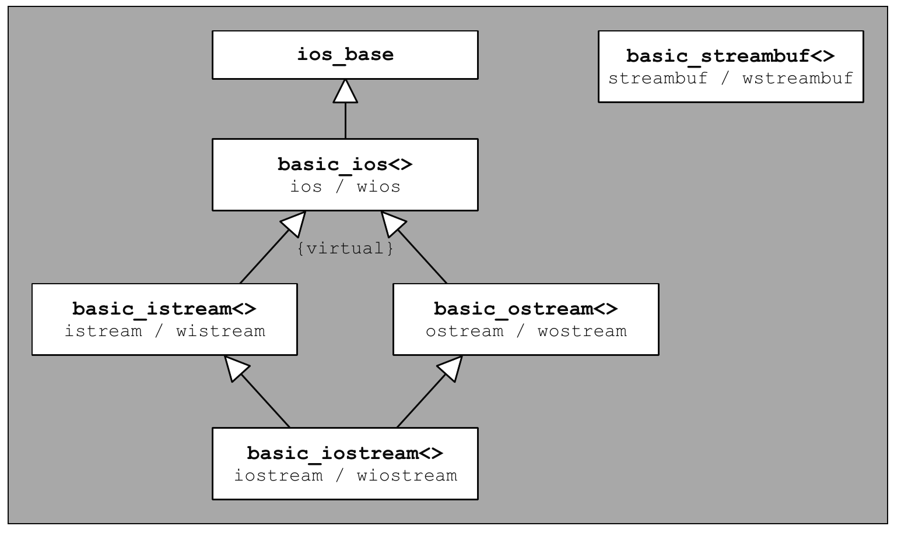

Chương 15 giới thiệu thư viện IOStream: định dạng và trao đổi dữ liệu với bàn phím, màn hình, file, string hoặc các biểu diễn khác. Phần này theo mục 15.1–15.2.1, trang 743–750.

## Các thay đổi C++11 sách nêu

C++11 bổ sung `hexfloat`, `defaultfloat`, các manipulator ngày giờ và tiền tệ; ngoại lệ I/O có thêm thông tin thông qua `std::system_error`. File stream và string stream hỗ trợ move, swap và có thể dùng tạm thời; file stream nhận tên file là `std::string`; các toán tử I/O hỗ trợ `long long` và `unsigned long long`. Sách cũng nêu hỗ trợ đồng thời một phần, traits cho `char16_t`/`char32_t`, và `wbuffer_convert` để chuyển đổi biểu diễn ký tự. Các tiện ích chuyển đổi cũ có tình trạng khác nhau ở những chuẩn mới, nên cần xét phiên bản khi áp dụng.

## Stream và các kênh chuẩn

Stream là đối tượng biểu diễn dòng dữ liệu. Với output, chương trình đưa dữ liệu vào stream; với input, chương trình trích xuất dữ liệu từ stream. `std::istream` và `std::ostream` là các specialization của lớp template tương ứng cho `char`.

| Đối tượng | Vai trò | Kênh thường tương ứng |
| --- | --- | --- |
| `std::cin` | Nhập chuẩn | `stdin` |
| `std::cout` | Xuất chuẩn | `stdout` |
| `std::cerr` | Xuất lỗi; mặc định bật `unitbuf` để yêu cầu đồng bộ sau thao tác output | `stderr` |
| `std::clog` | Ghi log; không bật `unitbuf` mặc định | Thường cùng đích với `stderr` |

Các kênh có thể được hệ điều hành chuyển hướng. Việc tách output thường và output lỗi cho phép lưu kết quả vào file trong khi vẫn xem lỗi trên terminal. Mô tả `cerr` “không buffer” trong sách là cách nói gần đúng: `unitbuf` yêu cầu flush thường xuyên, không khẳng định không tồn tại bộ đệm.

## Toán tử và manipulator

`>>` trích xuất, `<<` chèn dữ liệu; chúng trả stream để có thể nối thao tác. Kiểm tra stream sau khi đọc để không sử dụng giá trị khi nhập thất bại:

```cpp
#include <cstdlib>
#include <iostream>

int main() {
    double x, y;
    std::cout << "first operand: ";
    if (!(std::cin >> x)) {
        std::cerr << "error while reading first operand\n";
        return EXIT_FAILURE;
    }
    std::cout << "second operand: ";
    if (!(std::cin >> y)) {
        std::cerr << "error while reading second operand\n";
        return EXIT_FAILURE;
    }
    std::cout << x << " times " << y << " equals " << x * y << '\n';
}
```

Tương tự, `while (std::cin >> a >> b)` tiếp tục khi cả hai phép đọc thành công. Một manipulator có thể thay đổi định dạng hoặc thực hiện hành động ngay:

| Manipulator | Tác dụng |
| --- | --- |
| `std::endl` | Ghi newline rồi flush stream. |
| `std::ends` | Ghi ký tự null. |
| `std::flush` | Flush stream. |
| `std::ws` | Đọc và bỏ khoảng trắng đầu trong input. |
| `std::dec`, `std::hex`, `std::oct` | Chọn cơ số định dạng số nguyên. |

Nếu chỉ cần xuống dòng, `'\n'` không yêu cầu flush như `std::endl`. Flush yêu cầu đồng bộ buffer của stream; nó không tự đảm bảo dữ liệu đã được lưu bền vững trên thiết bị.

## Hệ phân cấp lớp



*Hình 15.1 trong sách: quan hệ các lớp stream và lớp stream buffer.*

- `ios_base` quản lý các thành phần không phụ thuộc kiểu ký tự, gồm trạng thái và cờ định dạng.
- `basic_ios<CharT, Traits>` bổ sung trạng thái phụ thuộc kiểu ký tự và liên kết tới `basic_streambuf`.
- `basic_istream` và `basic_ostream` kế thừa ảo `basic_ios`, cung cấp giao diện đọc và ghi. `basic_iostream` kết hợp cả hai.
- `basic_streambuf` cung cấp giao diện đệm và chuyển ký tự tới hoặc từ biểu diễn bên dưới. Các lớp file buffer, string buffer hoặc buffer tự viết có thể thực hiện phần truy cập cụ thể.

Cách tách stream và stream buffer cho phép tái sử dụng giao diện định dạng với nhiều nguồn/đích. Định dạng còn được hỗ trợ bởi các facet trong locale; chi tiết buffer và locale nằm ở các mục sau và chương 16. Traits mô tả các thao tác trên ký tự và giá trị EOF; specialization thông dụng là `char_traits<char>` và `char_traits<wchar_t>`, với traits cho `char16_t` và `char32_t` từ C++11. Tên `ios`, `istream`, `ostream`, `iostream`, `streambuf` là các specialization cho `char`; các tên có tiền tố `w` tương ứng `wchar_t`.
