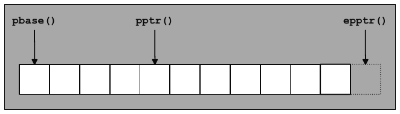

Phần này theo mục 15.13.3, trang 832–838 của sách. Tự viết một lớp dẫn xuất `std::streambuf` cho phép kết nối giao diện stream với đích dữ liệu mới hoặc biến đổi dữ liệu khi ghi.

## Vùng put và các con trỏ



*Hình 15.4 trong sách: vùng put của stream buffer.*

- `pbase()` là đầu vùng output buffer.
- `pptr()` là vị trí ghi kế tiếp; `[pbase(), pptr())` chứa dữ liệu đã đưa vào buffer nhưng chưa được chuyển hết tới đích.
- `epptr()` là vị trí ngay sau vùng có thể ghi.

Khi còn chỗ, `sputc()` có thể ghi trực tiếp và tăng con trỏ. Khi không còn chỗ, nó gọi virtual `overflow()` để xử lý dữ liệu chờ và ký tự mới. `sputn()` gọi `xsputn()`; lớp dẫn xuất có thể override hàm này để ghi theo khối hiệu quả hơn. `sync()` thực hiện yêu cầu đồng bộ, ví dụ khi stream được flush.

`setp(begin, end)` thiết lập vùng put; `pbump(n)` dịch vị trí hiện tại. Nếu không thiết lập vùng put, `overflow()` xử lý từng ký tự. Khi nhận `traits_type::eof()` như yêu cầu không kèm ký tự, trả `traits_type::not_eof(c)` nếu thành công, và `traits_type::eof()` khi thất bại.

## Ví dụ không đệm: chuyển chữ hoa

Ví dụ này dựa trên ý tưởng của sách nhưng ghi sang một `streambuf` đích để dễ kiểm tra và không phụ thuộc vào thiết bị cụ thể:

```cpp
#include <cassert>
#include <locale>
#include <ostream>
#include <sstream>
#include <streambuf>

class UpperBuffer : public std::streambuf {
    std::streambuf* destination;
protected:
    int_type overflow(int_type c) override {
        if (traits_type::eq_int_type(c, traits_type::eof()))
            return traits_type::not_eof(c);
        char ch = traits_type::to_char_type(c);
        ch = std::use_facet<std::ctype<char>>(getloc()).toupper(ch);
        if (traits_type::eq_int_type(destination->sputc(ch), traits_type::eof()))
            return traits_type::eof();
        return traits_type::not_eof(c);
    }
    int sync() override { return destination->pubsync(); }
public:
    explicit UpperBuffer(std::streambuf* dest) : destination(dest) {}
};

int main() {
    std::ostringstream storage;
    UpperBuffer buffer(storage.rdbuf());
    std::ostream out(&buffer);
    out << "31 hexadecimal: " << std::hex << 31 << std::flush;
    assert(out && storage.str() == "31 HEXADECIMAL: 1F");
}
```

Không có put area nên `overflow` được gọi cho từng ký tự; facet `ctype<char>` của locale thực hiện chuyển chữ hoa. Buffer đích phải tồn tại lâu hơn `UpperBuffer`. Ghi lỗi được báo qua EOF và trạng thái stream; `sync` chuyển yêu cầu flush xuống buffer đích. Cách này làm việc trên `char` theo locale, không tự xử lý chữ hoa Unicode UTF-8.

## Ghi theo khối và buffer có đệm

Sách đưa một output buffer nhận file descriptor hệ điều hành, override `overflow()` để ghi một ký tự và `xsputn()` để ghi một dãy. File descriptor và `write()` là giao diện phụ thuộc nền tảng, không phải API file stream portable. Một lời gọi ghi cấp thấp có thể ghi ít hơn yêu cầu hoặc bị gián đoạn; implementation thực tế phải xử lý phần còn lại và báo lỗi chính xác, thay vì giả định mọi byte đều được ghi.

Ví dụ có đệm trong sách dùng `setp()` để dành một ô xử lý trong `overflow`, đẩy dữ liệu khi đầy, và override `sync()` để flush. Khi thiết kế lớp tương tự, cần giữ lại phần chưa ghi nếu đích chỉ nhận một phần; `overflow` phải xử lý cả ký tự mới lẫn dữ liệu chờ và trả mã theo traits. Destructor không thể báo lỗi một cách thuận tiện, nên chương trình cần flush/đóng và kiểm tra kết quả tường minh trước khi hủy buffer.

Ví dụ sau minh họa put area với đích là một stream buffer khác. Nó giữ phần chưa được đích nhận nếu ghi ngắn và báo thất bại cho stream gọi; ví dụ không tự thử lại khi đích báo lỗi:

```cpp
#include <cassert>
#include <cstring>
#include <ostream>
#include <sstream>
#include <streambuf>

class BufferedOutput : public std::streambuf {
    char buffer[8];
    std::streambuf* destination;

    bool flush_pending() {
        const std::streamsize pending = pptr() - pbase();
        if (pending == 0) return true;
        const std::streamsize written = destination->sputn(pbase(), pending);
        const std::streamsize remaining = pending - written;
        std::memmove(buffer, buffer + written, static_cast<std::size_t>(remaining));
        setp(buffer, buffer + sizeof buffer);
        pbump(static_cast<int>(remaining));
        return remaining == 0;
    }

protected:
    int_type overflow(int_type c) override {
        if (!flush_pending()) return traits_type::eof();
        if (!traits_type::eq_int_type(c, traits_type::eof())) {
            *pptr() = traits_type::to_char_type(c);
            pbump(1);
        }
        return traits_type::not_eof(c);
    }
    int sync() override {
        if (!flush_pending()) return -1;
        return destination->pubsync() == 0 ? 0 : -1;
    }

public:
    explicit BufferedOutput(std::streambuf* dest) : destination(dest) {
        setp(buffer, buffer + sizeof buffer);
    }
};

int main() {
    std::ostringstream storage;
    BufferedOutput buffer(storage.rdbuf());
    std::ostream out(&buffer);
    out << "abcdefghijk" << std::flush;
    assert(out && storage.str() == "abcdefghijk");
}
```

Trong ví dụ, `flush_pending()` chuyển vùng `[pbase(), pptr())`, dời phần chưa ghi về đầu buffer rồi cập nhật lại put area. `overflow()` chỉ thêm ký tự mới sau khi đã có chỗ; `sync()` còn chuyển yêu cầu đồng bộ xuống đích. Buffer không sở hữu đích và không tự flush trong destructor, nên đích phải tồn tại đủ lâu và caller cần flush, kiểm tra lỗi trước khi kết thúc.

Sách cũng trình bày bản template cho `charT` và `Traits`: với tên phụ thuộc lớp cơ sở template, có thể cần `this->getloc()`. Kết quả EOF phải được so sánh và tạo bằng các hàm của `Traits`, không giả định mọi kiểu ký tự dùng trực tiếp hằng `EOF` của C.
