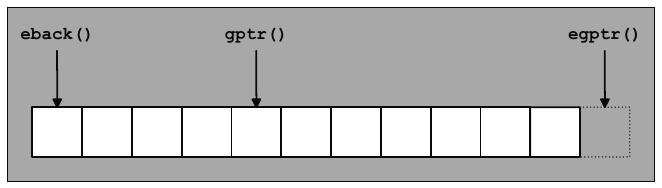
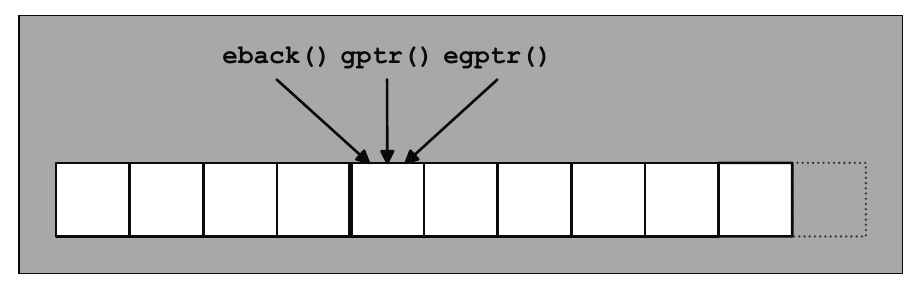
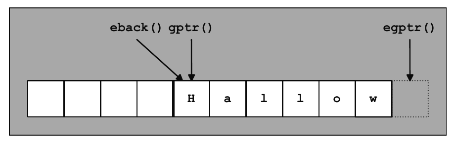
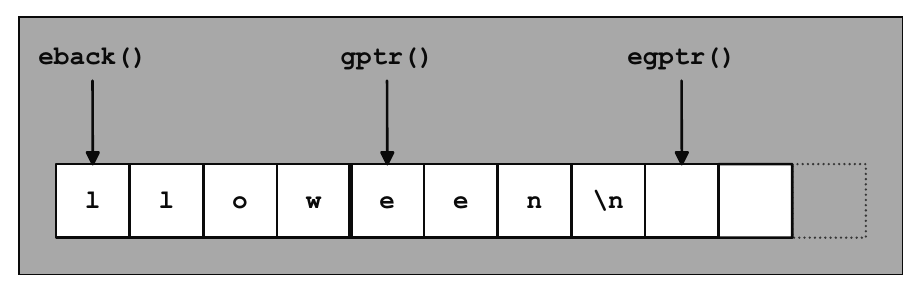

Phần này theo mục 15.13.3, trang 839–844. Input buffer cần hỗ trợ cả xem ký tự mà chưa lấy đi và đưa ký tự đã đọc trở lại khi có thể.

## Vùng get



*Hình 15.5 trong sách: vùng get và vị trí đọc.*

- `eback()` là đầu vùng có thể lùi lại mà không cần xử lý đặc biệt.
- `gptr()` là vị trí ký tự kế tiếp được đọc.
- `egptr()` là vị trí sau ký tự cuối hiện có trong vùng get.

`[gptr(), egptr())` là dữ liệu đã nạp nhưng chưa được lấy. `setg(begin, current, end)` thiết lập ba vị trí trên; vùng `[eback(), gptr())` có thể giữ các ký tự phục vụ putback.

`sgetc()` xem ký tự hiện tại mà không tiến; `sbumpc()` lấy và tiến. Nếu vùng get rỗng, `underflow()` có thể nạp dữ liệu mới và trả ký tự hiện tại mà không tiêu thụ nó. Khi cần lấy ký tự mà không còn sẵn trong vùng get, `uflow()` xử lý việc tiêu thụ; implementation mặc định dựa vào `underflow()` và tiến con trỏ. `xsgetn()` có thể được override để đọc theo khối hiệu quả hơn.

Nếu không thiết lập vùng get, implementation phải tự đảm bảo khác biệt giữa xem và tiêu thụ ký tự; chỉ override `underflow()` rồi đọc mất ký tự sẽ làm `peek()` hoạt động sai. `pbackfail()` xử lý putback khi không thể lùi trực tiếp trong vùng get; khả năng putback phụ thuộc buffer.

## Ví dụ giữ bốn ký tự để putback

Sách dùng buffer 10 ký tự, dành tối đa bốn ký tự cũ cho putback và nạp tối đa sáu ký tự mới qua `read()` của hệ điều hành. Ví dụ dưới thay nguồn file descriptor bằng string trong bộ nhớ để tập trung vào quản lý con trỏ và chạy độc lập:



*Hình 15.6 trong sách: vùng get sau khởi tạo · trang 843 (PDF trang 872).*

Khi khởi tạo, `eback()`, `gptr()` và `egptr()` cùng trỏ vào đầu vùng dữ liệu mới; vùng chưa đọc đang rỗng.



*Hình 15.7 trong sách: vùng get sau lần nạp `Hallow` · trang 843 (PDF trang 872).*

Lần nạp đầu đưa sáu ký tự vào vùng đọc; chưa có ký tự cũ để đưa lại. Sau khi sáu ký tự này được tiêu thụ, lần nạp tiếp theo giữ bốn ký tự cuối ở vùng putback và nạp thêm dữ liệu:



*Hình 15.8 trong sách: `llow` trong vùng putback, theo sau bởi `een` và newline mới nạp · trang 843 (PDF trang 872).*

Hình trong sách dùng nguồn kết thúc bằng newline; ví dụ mã dưới dùng `"Halloween"` nên khối cuối chỉ có ba ký tự `een`. Cách các con trỏ và vùng putback hoạt động vẫn tương tự.

```cpp
#include <algorithm>
#include <cassert>
#include <cstring>
#include <istream>
#include <streambuf>
#include <string>

class ChunkBuffer : public std::streambuf {
    static const std::size_t putback = 4;
    static const std::size_t chunk = 6;
    char buffer[putback + chunk];
    std::string source;
    std::size_t offset;
protected:
    int_type underflow() override {
        if (gptr() < egptr()) return traits_type::to_int_type(*gptr());
        const std::size_t kept = std::min<std::size_t>(putback, gptr() - eback());
        std::memmove(buffer + putback - kept, gptr() - kept, kept);
        const std::size_t count = std::min(chunk, source.size() - offset);
        if (count == 0) return traits_type::eof();
        std::memcpy(buffer + putback, source.data() + offset, count);
        offset += count;
        setg(buffer + putback - kept, buffer + putback, buffer + putback + count);
        return traits_type::to_int_type(*gptr());
    }
public:
    explicit ChunkBuffer(const std::string& text) : source(text), offset(0) {
        setg(buffer + putback, buffer + putback, buffer + putback);
    }
};

const std::size_t ChunkBuffer::putback;
const std::size_t ChunkBuffer::chunk;

int main() {
    ChunkBuffer buffer("Halloween");
    std::istream in(&buffer);
    char c;
    std::string first;
    for (int i = 0; i < 8 && in.get(c); ++i) first += c;
    assert(first == "Hallowee");
    in.unget();
    in.unget();
    std::string rest;
    while (in.get(c)) rest += c;
    assert(rest == "een");
}
```

Khi nạp khối mới, `memmove` giữ tối đa bốn ký tự đã đọc gần nhất trước vùng dữ liệu mới; `setg` cập nhật đầu, vị trí hiện tại và cuối. Ban đầu ba con trỏ trùng nhau để lần đọc đầu gọi `underflow`. Hai `unget()` trong ví dụ dùng lại hai ký tự đã đọc gần nhất. Với nguồn hệ điều hành thực tế, phải xử lý riêng EOF, lỗi và các lần đọc bị gián đoạn; ví dụ sách dùng `read()` phụ thuộc nền tảng.
