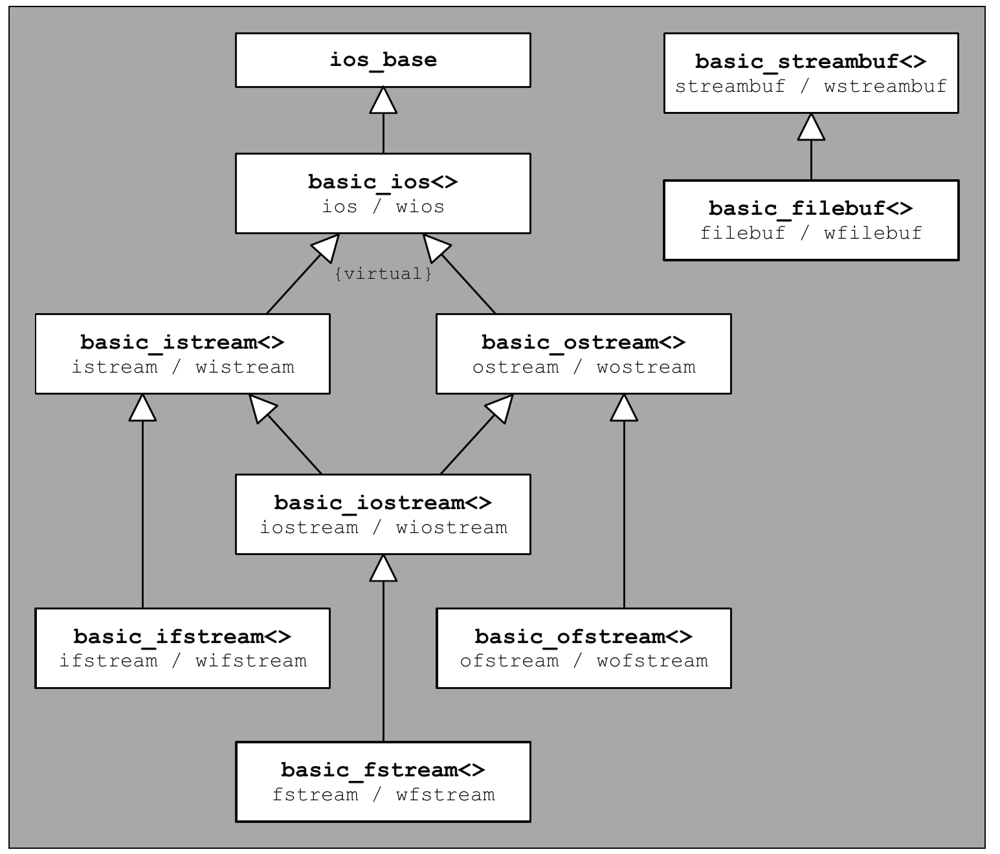

Phần này theo mục 15.8–15.9.3, trang 790–796 của sách.

## Locale của stream

Mỗi stream có locale riêng, ban đầu được sao chép từ global locale khi stream được tạo. Locale ảnh hưởng, chẳng hạn, dấu thập phân và cách biểu diễn Boolean dạng chữ. `stream.imbue(loc)` đặt locale, còn `stream.getloc()` lấy locale hiện tại. Điều này cho phép các stream dùng quy tắc định dạng khác nhau trong cùng chương trình.

`stream.widen(c)` chuyển một ký tự `char` trong tập ký tự cơ bản sang kiểu ký tự của stream thông qua locale; `stream.narrow(c, fallback)` chuyển ngược khi có thể, nếu không thì trả fallback. Đây là thao tác trên một ký tự theo facet, không phải bộ chuyển mã tổng quát cho toàn bộ chuỗi UTF-8. Chi tiết locale nằm ở chương 16.

## Các lớp file stream

`<fstream>` cung cấp `ifstream` để đọc, `ofstream` để ghi, `fstream` để đọc và ghi. Các phiên bản wide là `wifstream`, `wofstream`, `wfstream`. Các lớp này dùng `basic_filebuf` để kết nối stream với file.



*Hình 15.2 trong sách: các lớp file stream và file buffer.*

Constructor nhận tên file sẽ thử mở ngay; kiểm tra trạng thái sau khi mở. File đang mở được đóng khi đối tượng hủy. Nếu cần phát hiện lỗi ghi hoặc đóng, kiểm tra trạng thái sau `flush()` hoặc `close()` tường minh: destructor không phải nơi thuận tiện để báo lỗi cho người gọi.

```cpp
#include <fstream>
#include <iostream>
#include <string>

int main() {
    const std::string filename("example.txt");
    {
        std::ofstream out(filename); // mở để ghi; mặc định có thể xóa nội dung cũ
        if (!out) return 1;
        out << "hello\n";
        out.close();
        if (!out) return 1;
    }
    std::ifstream in(filename);
    if (!in) return 1;
    char c;
    while (in.get(c)) std::cout.put(c);
    if (in.bad() || !std::cout) return 1;
}
```

Từ C++11, constructor file stream nhận `std::string`; trước đó dùng `filename.c_str()`. Cũng có thể ghi `std::cout << in.rdbuf()` để chuyển nội dung buffer; xem thêm cách kiểm tra lỗi và sao chép ở mục 15.14. Ví dụ sách ghi bảng mã ký tự 32–255 vào file rồi đọc lại; ý nghĩa các giá trị phụ thuộc biểu diễn ký tự của hệ thống.

## Move và stream tạm thời

Từ C++11, file stream hỗ trợ move construction, move assignment và swap; có thể trả stream từ hàm. Stream tạm cũng có thể tham gia I/O, ví dụ `std::ofstream("file.txt") << "hello\n";`. Khi cần kiểm tra lỗi mở, ghi và đóng, dùng đối tượng có tên giúp kiểm tra trạng thái rõ hơn.

## Chế độ mở

| Cờ `std::ios` | Ý nghĩa |
| --- | --- |
| `in` | Mở để đọc; được `ifstream` thêm mặc định. |
| `out` | Mở để ghi; được `ofstream` thêm mặc định. |
| `app` | Đưa vị trí ghi tới cuối trước mỗi lần ghi. |
| `ate` | Đặt vị trí tại cuối ngay sau khi mở; sau đó có thể seek nếu hỗ trợ. |
| `trunc` | Cắt nội dung file khi mở theo tổ hợp chế độ hợp lệ. |
| `binary` | Yêu cầu chế độ nhị phân của nền tảng, tránh các chuyển đổi text-mode như newline nếu nền tảng có. |

Các cờ là bitmask và có thể kết hợp bằng `|`, nhưng không phải tổ hợp nào cũng hợp lệ. `app` khác `ate`: một cờ ảnh hưởng mỗi lần ghi, một cờ chỉ đặt vị trí ban đầu. `ofstream` mặc định với `out` thường mở theo chế độ cắt file hiện có; cần chọn `app` khi muốn nối tiếp.

Khi một `fstream` vừa đọc vừa ghi, tuân thủ quy tắc chuyển hướng I/O của file buffer và hệ thống; dùng thao tác định vị hoặc đồng bộ phù hợp khi đổi giữa đọc và ghi, và xử lý cờ EOF trước khi tiếp tục. Sách lưu ý các quy tắc này liên quan hành vi file C bên dưới; không giả định chuyển đổi tùy ý luôn hoạt động.
