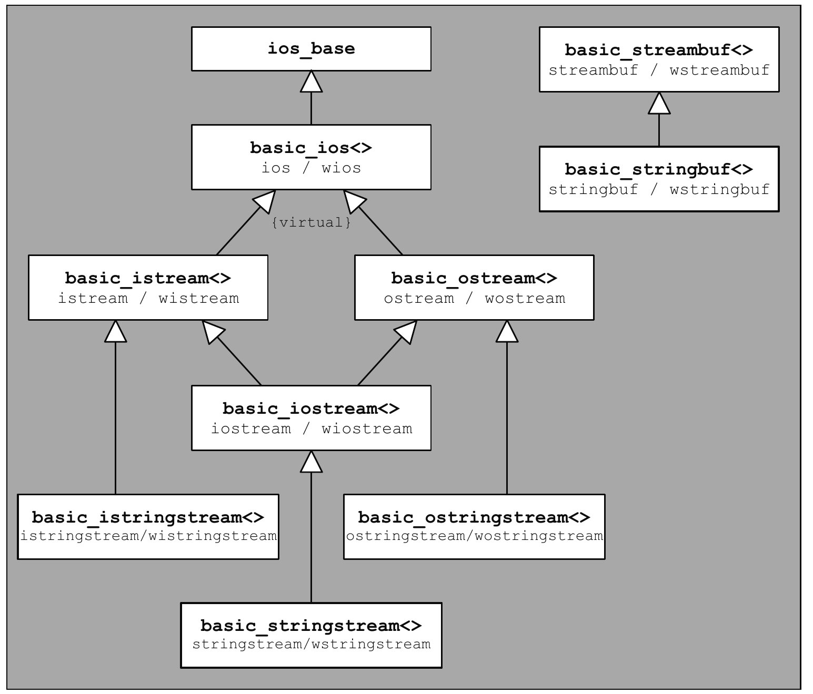

Phần này theo mục 15.10, trang 802–809. String stream dùng giao diện stream với bộ đệm trong bộ nhớ, hữu ích để định dạng nội dung trước khi gửi hoặc phân tích từng dòng đã đọc.

## Các lớp trong `<sstream>`

| Kiểu | Công dụng |
| --- | --- |
| `std::istringstream` | Đọc từ string. |
| `std::ostringstream` | Ghi vào string. |
| `std::stringstream` | Đọc và ghi. |
| `std::stringbuf` | Bộ đệm chuỗi được các stream sử dụng. |

Các template `basic_...` còn có specialization `w...` cho `wchar_t` và tham số traits, allocator.



*Hình 15.3 trong sách.*

`str()` lấy nội dung bộ đệm thành string; `str(s)` thay nội dung buffer bằng bản sao của `s`. Trong giao diện C++11 của sách, sửa string nguồn sau khi tạo stream không làm nội dung stream tự thay đổi và ngược lại.

## Ghi và thay nội dung

```cpp
#include <cassert>
#include <iomanip>
#include <sstream>
#include <string>

int main() {
    std::ostringstream out;
    out << "dec: " << 15 << " hex: " << std::hex << 15;
    assert(out.str() == "dec: 15 hex: f");
    out.seekp(0);
    out << "oct: " << std::oct << 15;
    assert(out.str() == "oct: 17 hex: f");
    out.str(""); // thay toàn bộ nội dung, thay vì chỉ ghi đè đầu buffer
    out.clear();  // xóa cờ lỗi nếu stream đã gặp lỗi
    out << std::dec << 42;
    assert(out.str() == "42");
}
```

`seekp(0)` chỉ thay vị trí ghi: ký tự cũ chưa bị ghi đè vẫn còn. Đặt `str("")` thay nội dung; `clear()` xử lý **trạng thái stream**, không phải nội dung. Cờ định dạng như `hex` hay `oct` cũng tồn tại đến khi được đổi, do đó ví dụ đặt `dec` trước khi ghi lại.

Với `std::ostringstream out(initial, std::ios::out | std::ios::ate)`, vị trí ghi ban đầu ở cuối bản sao `initial`, nên output mới nối vào cuối. String nguồn vẫn không đổi.

## Đọc từ string và move

```cpp
#include <cassert>
#include <sstream>
#include <string>

int main() {
    std::istringstream in("3.7");
    int integer;
    double fraction;
    assert(in >> integer >> fraction);
    assert(integer == 3 && fraction > 0.69 && fraction < 0.71);
    in.str("42");
    in.clear(); // đặt lại EOF/fail nếu có trước khi đọc dữ liệu mới
    assert(in >> integer && integer == 42);
}
```

Phép đọc số nguyên dừng trước dấu chấm, phép đọc số thực tiếp tục từ `.7`. Từ C++11, string stream hỗ trợ move và swap; có thể dùng input stream tạm trong biểu thức như `std::istringstream(name) >> first >> last`, nhưng nếu cần báo lỗi rõ ràng, giữ stream có tên để kiểm tra trạng thái từng phép đọc. Trước C++11, việc vô tình in chính stream thay vì `str()` có thể chọn chuyển đổi con trỏ cũ và in địa chỉ; từ C++11 chuyển đổi bool là tường minh.

Sách minh họa tách tên hai hoặc ba thành phần bằng string stream tạm. Ví dụ dưới giữ stream có tên để kiểm tra rõ đầu vào: hai từ được hiểu là tên và họ, ba từ có thêm tên đệm; quy tắc này chỉ là quy ước của ví dụ, không bao quát mọi cách đặt tên người.

```cpp
#include <cassert>
#include <sstream>
#include <string>
#include <tuple>

bool parseName(const std::string& text,
               std::tuple<std::string, std::string, std::string>& result) {
    std::istringstream in(text);
    std::string first, second, third, extra;
    if (!(in >> first >> second)) return false;
    if (in >> third) {
        if (in >> extra) return false;
        result = std::make_tuple(first, second, third);
    } else {
        result = std::make_tuple(first, "", second);
    }
    return true;
}

int main() {
    std::tuple<std::string, std::string, std::string> name;
    assert(parseName("Nico Josuttis", name));
    assert(std::get<1>(name).empty() && std::get<2>(name) == "Josuttis");
    assert(parseName("Nicolai M. Josuttis", name));
    assert(std::get<1>(name) == "M.");
    assert(!parseName("Mot", name));
}
```

Lần thử đọc từ thứ ba có thể đặt `eofbit` hoặc `failbit` khi tên chỉ có hai từ; điều đó không làm kết quả hai từ trở thành lỗi theo quy ước ở đây. Nếu muốn tái sử dụng chính stream này, cần đặt lại nội dung bằng `str(...)` và xóa trạng thái bằng `clear()` trước lần đọc tiếp theo.

## `strstream` cũ

Sách còn mô tả `<strstream>`: `istrstream`, `ostrstream`, `strstream`, `strstreambuf` dùng mảng `char` thay vì `std::string`. Giao diện này đã bị phản đối và bị loại khỏi chuẩn C++26; không nên dùng trong mã mới.

Với `ostrstream` có bộ đệm cấp phát động, `str()` làm buffer bị *freeze* và không tự thêm null. Ví dụ sách dùng `std::ends` để thêm null trước khi lấy con trỏ, rồi `freeze(false)` để buffer được stream quản lý lại. Buffer cố định do người gọi cung cấp có quy tắc sở hữu khác. Các chi tiết này dễ gây lỗi bộ nhớ; `ostringstream` và `str()` trả string giúp tránh việc tự quản lý đó.
