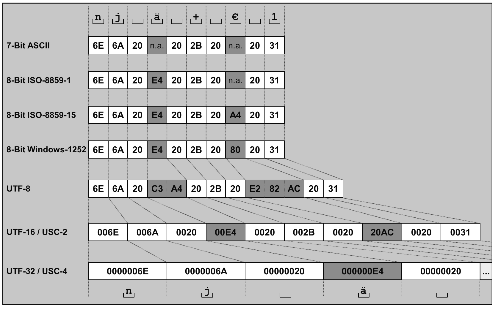

Phần này theo mục 16.1.1–16.1.3, trang 849–853. Quốc tế hóa (*internationalization*, viết tắt i18n) liên quan đến biểu diễn văn bản và các quy ước người dùng như định dạng số, ngày giờ, tiền tệ, phân loại và sắp xếp ký tự. C++ dùng character traits và locale để hỗ trợ nhiều khía cạnh này.

## Ký tự, code point và đơn vị mã hóa

Unicode gán **code point** cho các ký tự và thành phần khác; một **encoding** quy định cách biểu diễn chúng thành code unit hoặc byte. Một ký tự nhìn thấy có thể gồm nhiều code point, chẳng hạn chữ cơ sở và dấu kết hợp. Vì thế số byte, số code unit, số code point và số ký tự hiển thị không nhất thiết bằng nhau.

| Biểu diễn | Đặc điểm |
| --- | --- |
| ASCII | Tập ký tự 7-bit; không biểu diễn được phần lớn ký tự tiếng Việt. |
| ISO-8859-1, ISO-8859-15 | Các mã hóa một byte khác nhau; ISO-8859-15 có ký hiệu euro ở vị trí khác một số ký tự của ISO-8859-1. |
| UTF-8 | Mỗi Unicode scalar value dùng 1–4 byte; các ký tự ASCII dùng một byte. |
| UTF-16 | Mỗi scalar value dùng một hoặc hai code unit 16-bit; ký tự ngoài BMP dùng cặp surrogate. |
| UTF-32 | Mỗi scalar value được biểu diễn bằng một code unit 32-bit. |
| UCS-2 | Biểu diễn 16-bit lịch sử, không biểu diễn được các scalar value ngoài BMP như UTF-16. |

BOM có thể dùng để chỉ thị thứ tự byte trong một số định dạng UTF-16/UTF-32; quy tắc mặc định và cách diễn giải BOM phụ thuộc định dạng/giao thức. Các phiên bản BE/LE chỉ rõ thứ tự byte. UTF-8 không cần BOM để xác định thứ tự byte.



*Hình 16.1 trong sách: cùng một chuỗi có các biểu diễn hex khác nhau. Nhãn “USC” trong hình là lỗi in của “UCS”.*

Trong hình, `ä` được biểu diễn `C3 A4` trong UTF-8 và `00E4` dưới dạng code unit UTF-16; `€` là `E2 82 AC` trong UTF-8. Hình không có BOM. Các số 16-bit trong hàng UTF-16 là **code unit**, không tự xác định thứ tự các byte lưu trên đĩa.

Sách mô tả wide-character như ký tự luôn có kích thước cố định và nói UCS-2 là multibyte; cần hiểu chính xác hơn: code unit `wchar_t` có độ rộng cố định trên một implementation nhưng không nhất thiết biểu diễn trọn một ký tự Unicode; UCS-2 là biểu diễn 16-bit cũ, còn UTF-16 dùng một hoặc hai code unit. Các mã hóa multibyte có thể có trạng thái chuyển đổi, nhưng UTF-8 không cần shift state kiểu chuyển bảng mã được sách dùng làm ví dụ.

## Kiểu ký tự C++

- `char` thường chứa byte hoặc code unit của UTF-8; bản thân `std::string` không gắn nhãn hoặc xác thực mã hóa.
- `char16_t` và `char32_t` có từ C++11, thường dùng cho code unit UTF-16 và UTF-32; `u16string` và `u32string` không tự xác thực nội dung.
- `wchar_t` có độ rộng và quy ước phụ thuộc implementation; không đồng nhất với `char16_t` hay `char32_t` dù có thể có cùng kích thước.
- Từ C++20 còn có kiểu `char8_t` cho code unit UTF-8; đây là bổ sung sau phiên bản C++11 của sách.

```cpp
#include <cassert>
#include <string>

int main() {
    const std::string euro("\xE2\x82\xAC", 3); // UTF-8 cho U+20AC
    assert(euro.size() == 3); // ba phần tử char, không phải ba ký tự hiển thị
    const std::u16string wide = u"\u20AC";
    assert(wide.size() == 1); // một code unit UTF-16 cho U+20AC
}
```

C++11 có literal `u`, `U`, `L`, `u8` cho các dạng ký tự khác nhau; chú ý kiểu của literal `u8` thay đổi từ C++20. Hỗ trợ stream và facet mặc định cho `char16_t`/`char32_t` không tương đương sự hỗ trợ sẵn có cho `char`/`wchar_t` trong C++11.

Sách giới thiệu `ctype::widen/narrow`, `codecvt`, `wstring_convert` và `wbuffer_convert`; chúng có phạm vi và giới hạn riêng, không nên coi `widen/narrow` là bộ chuyển mã Unicode tổng quát. Một số tiện ích chuyển mã được sách mô tả đã bị phản đối hoặc loại khỏi các chuẩn mới; các mục sau sẽ trình bày theo ngữ cảnh C++11 của sách.
