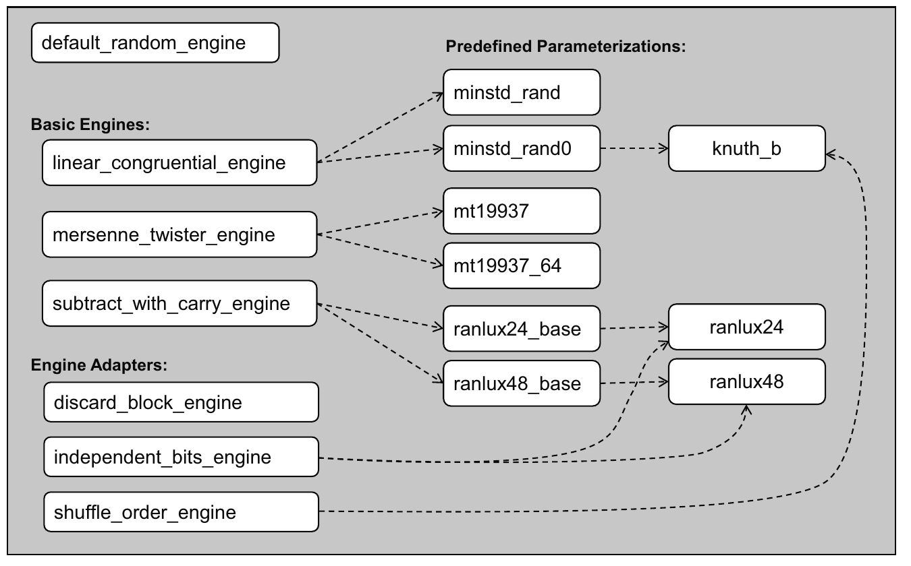

Phần này theo mục 17.1.2–17.1.4, trang 912–920 của sách. Hình dưới cho thấy các engine và adapter được sách trình bày.



*Hình 17.1 trong sách: basic engine, adapter và các cấu hình dựng sẵn.*

## Nhóm engine

| Nhóm | Các template |
| --- | --- |
| Engine cơ sở | `linear_congruential_engine`, `mersenne_twister_engine`, `subtract_with_carry_engine` |
| Adapter | `discard_block_engine`, `independent_bits_engine`, `shuffle_order_engine` |

Các cấu hình dựng sẵn gồm `minstd_rand0`, `minstd_rand`, `mt19937`, `mt19937_64`, `ranlux24_base`, `ranlux48_base`, `ranlux24`, `ranlux48` và `knuth_b`. `default_random_engine` là alias do implementation chọn. Với engine có thuật toán và tham số chuẩn xác định, cùng trạng thái tạo cùng dãy engine; đừng suy ra mọi distribution hoặc `shuffle` cũng tạo cùng kết quả trên mọi thư viện chỉ vì engine giống nhau.

Ba adapter biến đổi cách dùng kết quả của engine nền: `discard_block_engine` bỏ qua một phần giá trị theo từng khối; `independent_bits_engine` tạo giá trị với số bit chỉ định; `shuffle_order_engine` thay đổi thứ tự kết quả bằng một bảng nội bộ. Ví dụ, `knuth_b` ghép linear congruential engine với `shuffle_order_engine` có bảng 256 phần tử. Đây là cách cấu hình engine, không phải `std::shuffle` dùng để xáo trộn một container.

Sách khai triển cấu hình `knuth_b` để cho thấy quan hệ giữa alias và các template nền. Có thể viết tương đương bằng alias `minstd_rand0` đã được định nghĩa sẵn:

```cpp
#include <cassert>
#include <random>
#include <type_traits>

int main() {
    using ExplicitKnuth = std::shuffle_order_engine<std::minstd_rand0, 256>;
    static_assert(std::is_same<ExplicitKnuth, std::knuth_b>::value,
                  "knuth_b dung minstd_rand0 va bang 256 phan tu");
    ExplicitKnuth explicitEngine;
    std::knuth_b namedEngine;
    const auto first = explicitEngine();
    const auto second = namedEngine();
    assert(first == second);
}
```

Ở cấu hình C++11 này, `minstd_rand0` là linear congruential engine với các tham số `16807`, `0` và `2147483647`; `shuffle_order_engine` bọc engine đó để thay đổi thứ tự giá trị thông qua bảng. Cùng một trạng thái engine cho cùng dãy, nhưng điều này không có nghĩa giá trị sinh ra là bí mật hoặc không thể dự đoán.

## Thao tác engine

`result_type` là kiểu kết quả, `min()` và `max()` là hai cận bao gồm. Constructor mặc định dùng trạng thái khởi tạo mặc định; constructor nhận seed và `seed(value)` tạo trạng thái theo seed; `seed()` khôi phục trạng thái mặc định. Gọi `engine()` trả giá trị và tiến trạng thái; `discard(n)` tiến tương đương `n` lần gọi. Sao chép engine sao chép trạng thái; gọi bản sao không làm tiến engine gốc.

Các toán tử stream lưu và khôi phục trạng thái; trong giao diện sách C++11 có thể so sánh engine cùng kiểu bằng `==`/`!=`. Kiểm tra thao tác đọc thành công trước khi dùng trạng thái khôi phục.

Chuỗi trạng thái được ghi ra là biểu diễn để khôi phục engine, không phải danh sách các số ngẫu nhiên đã sinh. Nếu đọc lại nhiều lần từ cùng stream, cần đưa vị trí đọc về đầu và xóa cờ lỗi hoặc EOF trước khi đọc lần kế tiếp. Truyền engine theo giá trị cũng sao chép trạng thái: gọi cùng một hàm với cùng engine gốc chưa thay đổi có thể tạo lại cùng dãy. Truyền tham chiếu khi muốn các lần gọi cùng làm tiến một engine.

```cpp
#include <cassert>
#include <random>
#include <sstream>

int main() {
    std::mt19937 original(42);
    std::mt19937 copy = original;
    assert(original() == copy());
    std::stringstream state;
    state << original;
    auto expected = original();
    state >> original;
    assert(state && original() == expected);
    copy.seed(42);
    std::mt19937 fresh(42);
    copy.discard(2);
    fresh(); fresh();
    assert(copy() == fresh());
}
```

## Nhóm distribution

| Nhóm trong sách | Distribution |
| --- | --- |
| Đều | `uniform_int_distribution`, `uniform_real_distribution` |
| Bernoulli | `bernoulli_distribution`, `binomial_distribution`, `geometric_distribution`, `negative_binomial_distribution` |
| Poisson và liên quan | `poisson_distribution`, `exponential_distribution`, `gamma_distribution`, `weibull_distribution`, `extreme_value_distribution` |
| Chuẩn và liên quan | `normal_distribution`, `lognormal_distribution`, `chi_squared_distribution`, `cauchy_distribution`, `fisher_f_distribution`, `student_t_distribution` |
| Lấy mẫu | `discrete_distribution`, `piecewise_constant_distribution`, `piecewise_linear_distribution` |

Phần lớn là template với kiểu số nguyên hoặc số thực; `bernoulli_distribution` trả `bool`. Loại và điều kiện tham số khác nhau theo distribution.

Trong các template của sách, kiểu mặc định là `int` cho nhóm nhận `IntType` và `double` cho nhóm nhận `RealType`. Sách liệt kê các kiểu nguyên chuẩn từ `short` đến `long long` và biến thể unsigned, cùng `float`, `double`, `long double` cho số thực; nên chọn kiểu phù hợp thay vì giả định mọi kiểu số đều hợp lệ.

## Tham số và trạng thái distribution

`d(engine)` sinh một giá trị và làm tiến engine; `d.min()`/`d.max()` trả các cận theo hợp đồng của distribution. `param_type` đóng gói tham số: `d.param()` đọc, `d.param(p)` đặt tham số, `d(engine, p)` dùng tham số `p` cho lần gọi đó mà không thay bộ tham số lưu trong `d`. `reset()` xóa trạng thái nội bộ liên quan đến các lần sinh trước; một số distribution có thể lưu giá trị trung gian, nên muốn tái hiện toàn bộ kết quả cần xét **cả trạng thái engine lẫn distribution**.

```cpp
#include <cassert>
#include <random>

int main() {
    std::mt19937 engine(42);
    std::uniform_int_distribution<int> d(0, 20);
    std::uniform_int_distribution<int>::param_type other(100, 200);
    int x = d(engine, other);
    assert(x >= 100 && x <= 200);
    assert(d.a() == 0 && d.b() == 20); // tham số lưu trong d không đổi
    d.param(other);
    assert(d.a() == 100 && d.b() == 200);
}
```

Sách minh họa histogram bằng cách chuyển giá trị thực sang số nguyên trước khi đếm. Phép chuyển cắt về 0, nên nhóm gần 0 của phân phối chuẩn gồm cả giá trị âm và dương; không diễn giải các cột đó như những khoảng bằng cách làm tròn xuống. Các công thức và tham số của từng phân phối sẽ được trình bày tiếp.

## Khôi phục cả engine lẫn distribution

Một distribution có thể giữ trạng thái phụ giữa các lần gọi. Nếu cần tiếp tục cùng chuỗi ngay từ một điểm đã lưu, hãy lưu cả hai đối tượng và khôi phục cùng nhau. Ví dụ dùng `normal_distribution`, thay vì giả định chỉ lưu engine là đủ:

```cpp
#include <cassert>
#include <random>
#include <sstream>

int main() {
    std::mt19937 engine(42);
    std::normal_distribution<double> distribution(0.0, 1.0);
    distribution(engine);

    std::stringstream saved;
    saved << engine << '\n' << distribution;
    const double expected = distribution(engine);

    saved >> engine >> distribution;
    assert(saved);
    assert(distribution(engine) == expected);
}
```

Ví dụ so sánh việc khôi phục trong cùng chương trình và thư viện; không hứa rằng các thư viện khác nhau tạo cùng chuỗi distribution từ cùng seed. Nếu chỉ đặt lại engine mà vẫn giữ trạng thái phụ cũ của distribution, kết quả có thể không quay về chuỗi ban đầu. `distribution.reset()` bỏ trạng thái phụ đó, nhưng không đặt lại engine.
