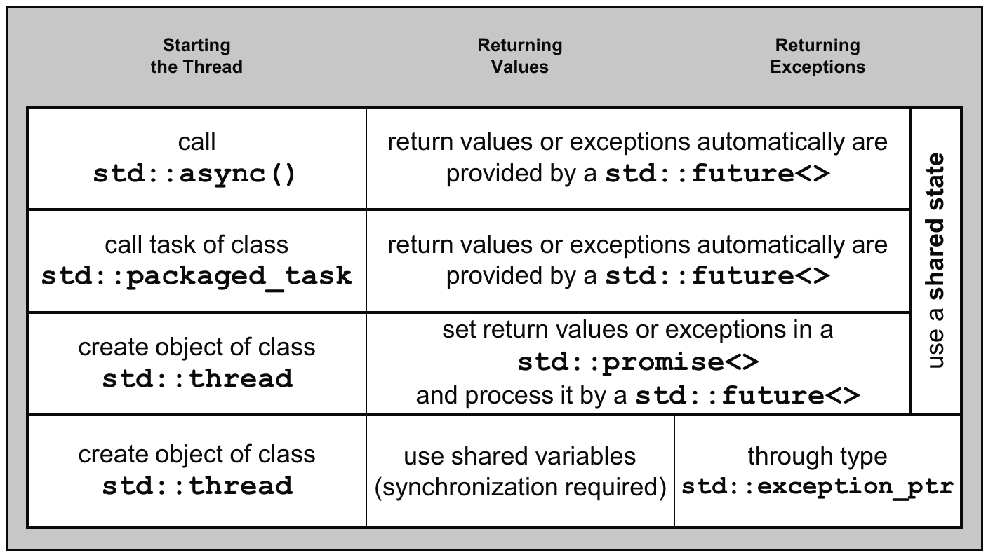

Phần này theo mục 18.2.2–18.3, trang 969–973. `promise`, `packaged_task`, `future` và `async` phối hợp thông qua **shared state** để truyền kết quả hoặc ngoại lệ.



*Hình 18.1 trong sách: các cách khởi chạy và truyền kết quả hoặc ngoại lệ.*

## `promise` và `future`

`std::promise<T>` là phía cung cấp kết quả; `get_future()` tạo future tương ứng, còn `set_value()` hoặc `set_exception()` đặt kết quả vào shared state. Khi state sẵn sàng, `future.get()` trả giá trị hoặc ném lại ngoại lệ đã lưu. Promise là kiểu move-only, và chỉ được thỏa mãn state một lần; cố đặt kết quả lần nữa gây `future_error`.

```cpp
#include <cassert>
#include <future>
#include <thread>
#include <utility>

int main() {
    std::promise<int> producer;
    std::future<int> result = producer.get_future();
    std::thread worker([](std::promise<int> p) {
        try {
            p.set_value(42);
        } catch (...) {
            p.set_exception(std::current_exception());
        }
    }, std::move(producer));
    worker.join();
    const int value = result.get();
    assert(value == 42);
}
```

`get_future()` chỉ lấy được một future từ một shared state của promise; dùng `.share()` nếu cần nhiều người quan sát. Nếu promise bị hủy mà chưa cung cấp kết quả, future tương ứng nhận lỗi `broken_promise`. `set_value()` làm state sẵn sàng nhưng không chứng minh thread đã kết thúc; nếu cần đợi thread kết thúc, dùng `join()` hoặc một cơ chế thích hợp.

`set_value_at_thread_exit()` và `set_exception_at_thread_exit()` lưu kết quả để state chỉ sẵn sàng khi thread thoát, sau các bước kết thúc liên quan đến thread-local. Sách minh họa promise truyền tham chiếu cho detached thread; khi áp dụng phải bảo đảm promise còn sống đủ lâu. Ví dụ trên chuyển quyền sở hữu promise vào thread và join để vòng đời rõ ràng.

Promise cũng dùng được trong một thread, như sách lưu ý. Ví dụ sau minh họa hai kết quả lỗi khác nhau: một ngoại lệ được đặt chủ động và lỗi `broken_promise` khi producer bị hủy mà chưa đặt kết quả:

```cpp
#include <cassert>
#include <exception>
#include <future>
#include <stdexcept>

int main() {
    std::promise<int> producer;
    auto result = producer.get_future();
    producer.set_exception(std::make_exception_ptr(std::runtime_error("failed")));
    bool taskError = false;
    try { (void)result.get(); }
    catch (const std::runtime_error&) { taskError = true; }
    assert(taskError);

    std::future<int> abandoned;
    {
        std::promise<int> unfinished;
        abandoned = unfinished.get_future();
    } // promise bị hủy mà chưa cung cấp kết quả
    bool broken = false;
    try { (void)abandoned.get(); }
    catch (const std::future_error& e) {
        broken = e.code() == std::make_error_code(std::future_errc::broken_promise);
    }
    assert(broken);
}
```

Hai trạng thái trên đều sẵn sàng khi `get()` xử lý chúng, nhưng nguyên nhân khác nhau. Một promise không được đặt vừa giá trị vừa ngoại lệ cho cùng state; lần đặt thứ hai báo `promise_already_satisfied`.

## `packaged_task`

`std::packaged_task<R(Args...)>` đóng gói callable và shared state. Lấy future bằng `get_future()`, rồi gọi task khi thích hợp; kết quả hoặc ngoại lệ từ callable được lưu để future nhận. Việc gọi task không tự tạo thread — có thể chạy trực tiếp hoặc chuyển task cho thread/executor.

```cpp
#include <cassert>
#include <future>
#include <thread>
#include <utility>

int multiply(int a, int b) { return a * b; }

int main() {
    std::packaged_task<int(int, int)> task(multiply);
    std::future<int> result = task.get_future();
    std::thread worker(std::move(task), 6, 7);
    worker.join();
    const int value = result.get();
    assert(value == 42);
}
```

`packaged_task` cũng move-only. Việc hủy `thread` còn joinable vẫn dẫn tới `terminate`; khi triển khai thực tế cần bảo đảm join kể cả trên đường ngoại lệ. `async` tạo task và future ở giao diện cao hơn, còn `thread` thuần cần cơ chế riêng nếu muốn chuyển kết quả hoặc ngoại lệ.
